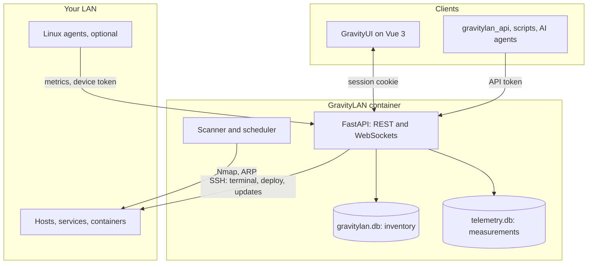

# Contributing to GravityLAN

Thank you for your interest in contributing! GravityLAN is a homelab-first project maintained with a focus on simplicity, clarity, and utility.

## How to Contribute

1. **Bug Reports**: Open an issue with a clear description and steps to reproduce.
2. **Feature Requests**: Describe the problem you're solving and why it fits the GravityLAN soul ([`SOUL.md`](SOUL.md)).
3. **Pull Requests**:
   - Follow the principles in [`SOUL.md`](SOUL.md) and the agent working rules in [`AGENT.md`](AGENT.md) / [`AGENTS.md`](AGENTS.md).
   - Keep changes focused, tested, and documented.
   - Ensure your code follows the existing style (PEP 8 + Ruff for Python; Vue 3 `<script setup>` + TypeScript + ESLint for GravityUI in `frontend-vue/`, see [`frontend-vue/DESIGN.md`](frontend-vue/DESIGN.md)).

## Architecture



Architecture Decision Records live in [`docs/adr/`](docs/adr) ([ADR-001 Agent Deployment](docs/adr/001-agent-deployment-architecture.md), [ADR-002 SSH Key Store](docs/adr/002-ssh-keystore.md), [ADR-003 React Retirement](docs/adr/003-react-retirement.md)). The route access policy matrix is generated via `scripts/security_matrix.py` into [`docs/security-matrix.md`](docs/security-matrix.md).

## Development Setup

**Windows:** `.\start_gravitylan.ps1` installs dependencies and starts Uvicorn on `:8000` and GravityUI on `:5174`.

**Linux and macOS:**

```bash
# Backend (Python 3.12+, Nmap installed)
cd backend
pip install -r requirements.lock.txt
python -m uvicorn app.main:app --reload --host 0.0.0.0 --port 8000

# GravityUI (Node 20/22+), in a second terminal: http://localhost:5174/frontend-vue/, proxies /api to :8000
cd frontend-vue
npm install
npm run dev
```

**Demo Backend (without touching your network):**
`python scripts/dev_demo.py` (in the backend virtualenv) starts the API on `127.0.0.1:8000` with a throw-away demo database, simulated agents with 24 hours of history, and a demo SSH shell, without running network scans. Start GravityUI as above and log in with password `demo`.
- `--reset` seeds the demo data again.
- `--fresh` starts like a new installation (setup wizard).
- `--company` loads a small company network (8 VLANs, a four-node Proxmox cluster, ~133 devices, four racks with ports and cables, backup links, own database).

**Tests and Quality Checks:**

```bash
cd frontend-vue && npm test && npm run typecheck && npm run lint   # GravityUI (Vitest, vue-tsc, ESLint)
cd backend && python -m pytest                                    # Backend (pytest)
python -m pytest gravitylan_api/tests                             # Python client (from repository root)
```

**Repository Layout:**

```text
agent/            Linux agent (gravitylan-agent.py) and systemd unit
backend/app/      FastAPI app: api/, models/, schemas/, scanner/, services/, database/
backend/tests/    Backend tests (pytest) and release upgrade fixtures
frontend-vue/     GravityUI (Vue 3, Vite, Tailwind, Pinia); design system in DESIGN.md
gravitylan_api/   Python REST API client
docs/             Configuration, agent, API, VLAN, Proxmox, Unraid, and security guides + ADRs
scripts/          Demo backend, release helpers, and security matrix generator
templates/        Official Unraid Community Applications template (gravitylan.xml)
```

## Security

If you discover a security vulnerability, please refer to [`SECURITY.md`](SECURITY.md).

## Code of Conduct

Be respectful, helpful, and honest. We're all here to build better homelabs.
