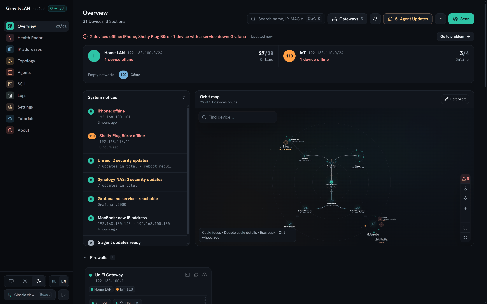
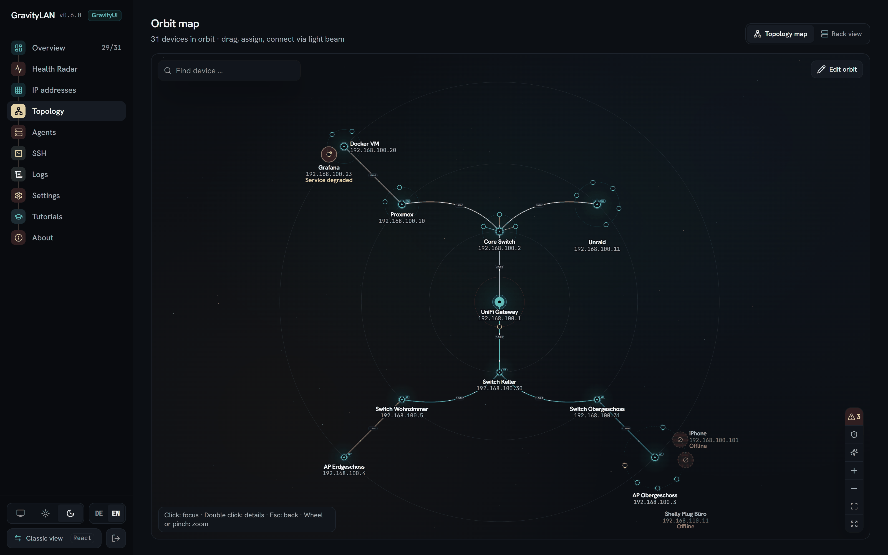
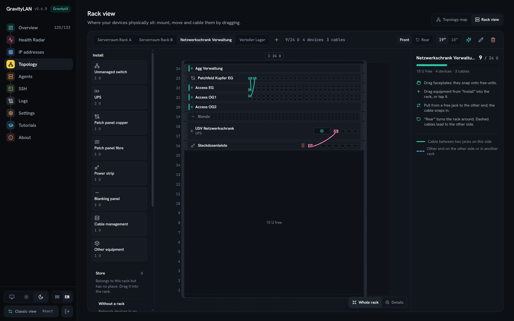

<div align="center">


# GravityLAN

**Dein Homelab, kartiert und im Griff.**<br>
Selbst gehostetes Netzwerk-Radar, Geräteinventar, interaktiver Orbit-Netzplan und Rack-Planer – mit optionalem Linux-Agenten und SSH-Terminal im Browser.

**[English](README.md)** · **Deutsch**

[](https://github.com/SleeperXr/GravityLAN/releases)
[](docs/linux-agent.md#deutsch)
[](https://github.com/SleeperXr/GravityLAN/actions/workflows/ci.yml)
[](https://hub.docker.com/r/sleeperxr/gravitylan)
[](LICENSE)

[Warum GravityLAN?](#warum-gravitylan) · [Schnellstart](#schnellstart) · [Unraid](#unraid) · [Gut zu wissen](#gut-zu-wissen) · [Dokumentation](#dokumentation) · [Releases](https://github.com/SleeperXr/GravityLAN/releases)

</div>

<p align="center">
  
</p>

## Was ist GravityLAN?

GravityLAN ist ein selbst gehostetes Dashboard für Heim- und Labornetze. Es durchsucht deine Subnetze, führt gefundene Hosts und Dienste in einem gemeinsamen Inventar und lässt dich ergänzen, was kein Scanner von selbst wissen kann: Gerätegruppen, physische Racks samt Verkabelung sowie Host- und Gast-Beziehungen. Alles läuft in einem einzigen Docker-Container auf Basis von SQLite – gebaut für vertrauenswürdige private Netze, nicht für die direkte Freigabe ins öffentliche Internet.

<table>
  <tr>
    <td width="50%" valign="top"><br><sub><b>Orbit-Netzplan</b>: hierarchische Topologie und berechnete Ausfallsicherheit</sub></td>
    <td width="50%" valign="top"><br><sub><b>Racks</b>: Frontblenden, passive Einbauten, Ports und Kabel</sub></td>
  </tr>
</table>
<p align="center"><sub>Beispielansichten einer früheren Version (Firmen-Demonetz); einzelne Bedienelemente können abweichen.</sub></p>

## Warum GravityLAN?

- **L2/L3-Erkennung & Subnetz-Karten:** Geplante Nmap- und ARP-Scans finden Hosts, offene Ports, Dienste und Hersteller in deinen Subnetzen. Multi-VLAN-Router bleiben ein einziges Gerät mit mehreren Schnittstellen, geteilte IPVLAN-MACs werden unterstützt, und abweichende MAC-Adressen werden als Konflikt zur Prüfung gemeldet, statt die Geräteidentität ungefragt zu überschreiben.
- **Interaktiver Orbit-Netzplan:** Stellt dein Netz rund um das Gateway mit Switches, Access Points, Hosts und Clients auf konzentrischen Umlaufbahnen dar. Verbindet den erkannten Online-Status mit deinen modellierten Links, um Single Points of Failure und Backup-Pfade aufzuzeigen – ohne eine echte Traffic-Messung zu behaupten.
- **Rack- & Kabel-Planer:** Baue Geräte und passive Ausstattung (Patchfelder, USV, Steckdosenleisten) per Drag-and-Drop in 19- oder 10-Zoll-Racks ein und verkable Ports auf Vorder- und Rückseite inklusive Undo-Funktion.
- **Health- & Verfügbarkeitsverlauf:** Verfolgt Erreichbarkeit, Latenz, Jitter, Flackern, SSL-Zertifikatsablauf und offene Sicherheits-Updates über 24 Stunden, 7 oder 30 Tage. Geräte, die nicht rund um die Uhr laufen, lassen sich als Clients einstufen und ziehen im Standby den Score nicht herunter.
- **Optionaler Linux-Agent & Patch-Management:** Ein schlankes Python-Skript meldet CPU, RAM, Laufwerke und Temperaturen, dient in gerouteten VLANs optional als Layer-2-ARP-Probe und erlaubt das Einspielen offener Paket-Updates per SSH direkt aus der Weboberfläche.
- **SSH-Terminal im Browser:** Öffne Multi-Tab-Shells am Desktop oder Smartphone mit verschlüsseltem Key-Store auf dem Server, Host-Key-Prüfung und erneuter Passwortbestätigung vor kritischen Aktionen.
- **Integrationen, Benachrichtigungen & API:** Importiere Subnetze vom Router (SNMP oder UniFi) sowie Gastnamen aus Proxmox VE im Lesezugriff, verschicke Meldungen über Webhooks, ntfy oder Gotify und nutze gescopte API-Tokens oder den Python-Client für Skripte und KI-Assistenten.

## Schnellstart

```bash
docker run -d --name gravitylan \
  -p 8000:8000 \
  -v gravitylan-data:/app/data \
  -e PUID=1000 -e PGID=1000 \
  --cap-add=NET_RAW --cap-add=NET_ADMIN \
  --restart unless-stopped \
  sleeperxr/gravitylan:latest
```

*Image-Tags:* `:latest` ist das aktuelle Release (siehe [Releases](https://github.com/SleeperXr/GravityLAN/releases)), `:X.Y.Z` hält eine feste Version, und `:next` ist der neueste Release-Candidate, für Tester.

Öffne `http://<dein-host>:8000` und schließe den Setup-Wizard ab: Er erkennt lokale Subnetze, startet den ersten Scan (oder spielt ein JSON-Backup ein) und legt das Admin-Passwort fest.

> [!IMPORTANT]
> **Schließe den Setup-Wizard direkt nach dem ersten Start ab** (ebenso nach einem Datenbank-Reset). Bis zum Abschluss des Setups legt derjenige das Admin-Passwort fest, der den Wizard zuerst öffnet.

**Docker-Compose-Varianten:**
- [`docker-compose.yml`](docker-compose.yml) — Bridge-Netzwerk auf Port `8000` (einfachster Start, durch NAT aber keine Layer-2-MAC-Erkennung außerhalb der Bridge).
- [`docker-compose.hostnet.yml`](docker-compose.hostnet.yml) — Host-Netzwerk (unter Linux empfohlen für direkte Layer-2-ARP-Scans, MAC-Adressen und mDNS).
- [`docker-compose.macvlan.yml`](docker-compose.macvlan.yml) & [`docker-compose.multi-vlan.yml`](docker-compose.multi-vlan.yml) — Eigene LAN-IP oder 802.1Q-Trunk-Schnittstellen über mehrere VLANs (siehe [Multi-VLAN-Einrichtung](docs/multi-vlan-setup.md#deutsch)).

## Unraid

GravityLAN bringt eine offizielle Vorlage in [`templates/gravitylan.xml`](templates/gravitylan.xml) mit, abgestimmt auf die Unraid-Standards (`PUID=99`, `PGID=100`, Appdata unter `/mnt/user/appdata/gravitylan`, `NET_RAW` und `NET_ADMIN` ohne Privileged-Modus). Standardmäßig nutzt sie das `host`-Netzwerk für volle Layer-2-Sichtbarkeit und unterstützt ebenso eigene `br0`- bzw. VLAN-Netze. Details und Hilfe bei Rechteproblemen stehen in [docs/unraid-template.md](docs/unraid-template.md).

## Gut zu wissen

- **Vertrauenswürdiges Netz & HTTPS:** GravityLAN ist für private Heim- und Labornetze konzipiert und gehört nicht direkt ins öffentliche Internet. Über unverschlüsseltes HTTP laufen Passwörter, Session-Cookies, hochgeladene Schlüssel und Terminal-Eingaben im Klartext durchs Netz – für einen ersten lokalen Test in Ordnung, für den dauerhaften Betrieb und das Browser-SSH-Terminal solltest du jedoch HTTPS über einen Reverse Proxy nutzen (`GRAVITYLAN_SECURE_COOKIES=true` und `GRAVITYLAN_TRUSTED_PROXIES` setzen). Für Fernzugriff empfiehlt sich ein VPN in Kombination mit HTTPS oder einem vorgeschalteten Auth-Proxy.
- **Layer-2- vs. Layer-3-Scans:** Router leiten keine ARP-Broadcasts über Subnetzgrenzen weiter. In gerouteten VLANs findet Nmap zwar Hosts und offene Ports (`L3 Geroutet`), für MAC-Adressen und Hersteller braucht es dort aber entweder eine Container-Schnittstelle im jeweiligen VLAN (`L2 Direkt`) oder einen Linux-Agenten im Subnetz mit eingeschalteter Layer-2-Probe (`L2 Probe`).
- **Einprozess- & Eininstanzbetrieb:** Betreibe genau einen Container und einen Worker-Prozess (`--workers 1`) pro Datenverzeichnis. Browser-Sitzungen, Passwortbestätigungen, Terminal-Tickets und der Scan-Scheduler liegen im Speicher dieses Prozesses.
- **JSON-Backup vs. vollständige Rollback-Sicherung:** Der JSON-Export unter *Einstellungen → Backup* sichert Inventar, Subnetze, Topologie, Racks, Verkabelung und allgemeine Einstellungen für den Umzug auf einen neuen Host. Ausgeschlossen sind Admin-Passwort, Master-Token, API-Tokens, Agent-Tokens, Webhook-Tokens, gespeicherte SSH-Keys/-Verbindungen, bekannte Hosts, Router-/Proxmox-Zugangsdaten, Messdatenverlauf und das Audit-Log. Stoppe vor einem Versions-Upgrade den Container und kopiere das gesamte Verzeichnis `/app/data` (sowie `GRAVITYLAN_VAULT_KEY`, falls extern gesetzt, bzw. deine externe Datenbank bei `GRAVITYLAN_DATABASE_URL`). Zusätzlich legt GravityLAN vor einer Datenbank-Migration automatisch bis zu drei Kopien von `gravitylan.db` unter `data/backups/` an.
- **Optionaler Docker-Socket:** Wenn du `/var/run/docker.sock` in den Container mountest, gleicht GravityLAN lokale Container anhand ihrer IP-Adresse mit dem Inventar ab. Ein gemounteter Docker-Socket gewährt dem Container weitreichende Rechte auf dem Host und ist vollständig optional.

## Dokumentation

| Thema | Dokument |
|---|---|
| **Konfiguration, Backup & Betrieb** | [docs/configuration.md](docs/configuration.md#deutsch) — Umgebungsvariablen, Reverse-Proxy-Setup, Backup/Rollback und UI-Überblick |
| **Multi-VLAN & geroutete Subnetze** | [docs/multi-vlan-setup.md](docs/multi-vlan-setup.md#deutsch) — Macvlan-Trunks, Agent als Layer-2-Probe und SNMP-/UniFi-Router-Import |
| **Linux-Agent & Paket-Updates** | [docs/linux-agent.md](docs/linux-agent.md#deutsch) — Installation per SSH oder Einzeiler, Agent-Update-Center, Patches und L2-Probe |
| **Proxmox-VE-Integration** | [docs/proxmox.md](docs/proxmox.md#deutsch) — Leserechte für API-Tokens, Gastnamen und Knoten-Zuordnung |
| **REST-API, Python-Client & KI-Agenten** | [docs/api-and-integrations.md](docs/api-and-integrations.md#deutsch) & [gravitylan_api/README.md](gravitylan_api/README.md) — Scopes, Read-Only-Tokens für KI-Assistenten, Webhooks |
| **Unraid-Vorlage** | [docs/unraid-template.md](docs/unraid-template.md#deutsch) — Parameter der Community-Applications-Vorlage und Zugriffsrechte |
| **Sicherheit & Härtung** | [SECURITY.md](SECURITY.md) · [Security-Matrix](docs/security-matrix.md) · [Container-Härtung](docs/container-hardening.md) · [Sicherheits-Baseline](docs/security-baseline.md) · [Bedrohungsmodell](docs/threat-model.md) |
| **Architektur & Entwicklung** | [CONTRIBUTING.md](CONTRIBUTING.md) · [ADRs](docs/adr) · [Designsystem](frontend-vue/DESIGN.md) · [Releasing](docs/RELEASING.md) · [Roadmap](docs/ROADMAP.md) · [Changelog](CHANGELOG.md) |

## Support, Mitmachen & Lizenz

- **Issues & Feedback:** Melde Fehler oder Vorschläge über [GitHub Issues](https://github.com/SleeperXr/GravityLAN/issues).
- **Mitmachen & Lokale Entwicklung:** In [CONTRIBUTING.md](CONTRIBUTING.md) findest du das lokale Entwickler-Setup, das Demo-Backend (`scripts/dev_demo.py --company`) und die Test-Befehle.
- **Lizenz:** [MIT](LICENSE) (siehe auch [THIRD_PARTY_NOTICES.md](THIRD_PARTY_NOTICES.md)). Entwickelt von **SleeperXr**.
