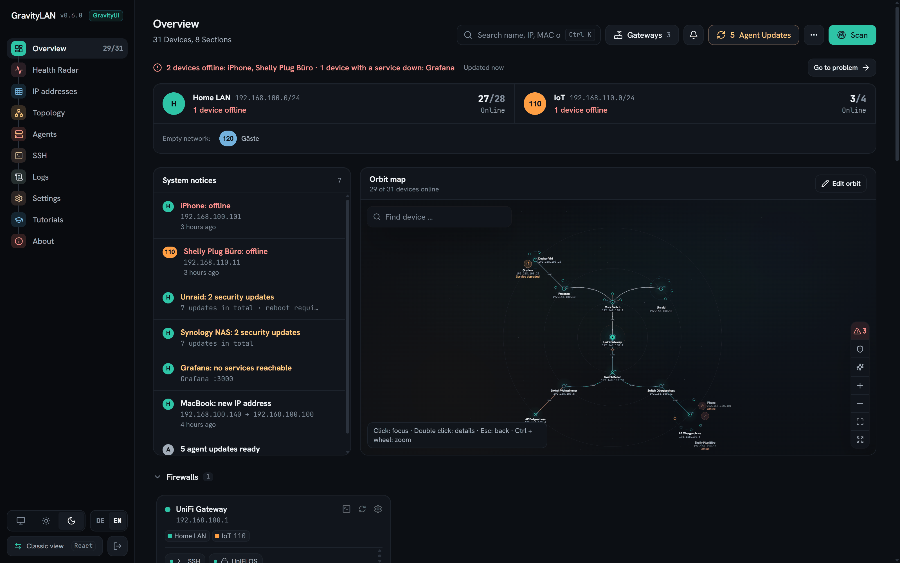
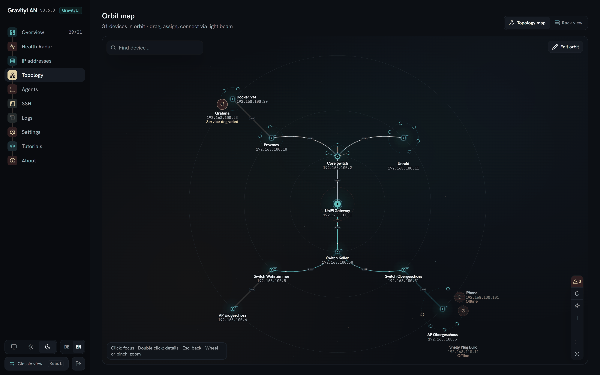
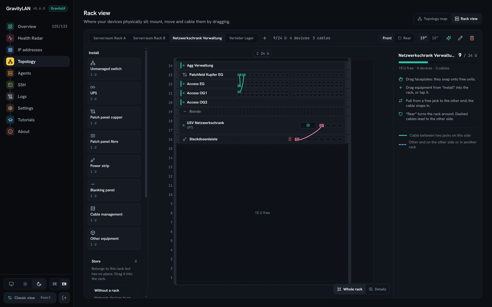

<div align="center">


# GravityLAN

**Your homelab, mapped and maintained.**<br>
Self-hosted network radar, device inventory, interactive orbit topology, and rack planner — with an optional Linux agent and in-browser SSH terminal.

**English** · **[Deutsch](README.de.md)**

[](https://github.com/SleeperXr/GravityLAN/releases)
[](docs/linux-agent.md)
[](https://github.com/SleeperXr/GravityLAN/actions/workflows/ci.yml)
[](https://hub.docker.com/r/sleeperxr/gravitylan)
[](LICENSE)

[Why GravityLAN?](#why-gravitylan) · [Quick Start](#quick-start) · [Unraid](#unraid) · [Good to Know](#good-to-know) · [Documentation](#documentation) · [Releases](https://github.com/SleeperXr/GravityLAN/releases)

</div>

> [!NOTE]
> **Published images.** The current release is **0.8.0**:
> - `sleeperxr/gravitylan:latest` and `sleeperxr/gravitylan:0.8.0` serve **`0.8.0`** (GravityUI-only, Proxmox VE sync, `Ctrl+K` search, Starlight/Aurora/custom themes, secondary DNS, pre-migration DB backups, MAC conflict review and manual MAC correction, the newest-on-top live log, the central route security matrix, and agent `0.3.17`). See the [release notes](https://github.com/SleeperXr/GravityLAN/releases/tag/v0.8.0).
> - `sleeperxr/gravitylan:next` follows release candidates and currently serves the same image as `0.8.0` (`0.8.0-rc.3`).
> - Changes merged to `main` after `0.8.0` are listed under `[Unreleased]` in the [changelog](CHANGELOG.md) and ship with the next release candidate.
>
> Always stop the container and back up your data directory before upgrading.

<p align="center">
  
</p>

## What is GravityLAN?

GravityLAN is a self-hosted dashboard for home and lab networks. It scans your subnets, keeps every discovered host and service in one inventory, and lets you model what a scanner cannot deduce on its own: device groups, physical racks with cabling, and host-to-guest relationships. Everything runs in a single Docker container backed by SQLite, designed for trusted private networks rather than direct exposure to the public internet.

<table>
  <tr>
    <td width="50%" valign="top"><br><sub><b>Orbit map</b>: hierarchical topology and calculated failover</sub></td>
    <td width="50%" valign="top"><br><sub><b>Racks</b>: hardware faceplates, passive equipment, ports, and cables</sub></td>
  </tr>
</table>
<p align="center"><sub>Sample screenshots from an earlier version (company demo network); individual controls may differ.</sub></p>

## Why GravityLAN?

- **L2/L3 Discovery & Subnet Maps:** Scheduled Nmap and ARP scans detect hosts, open ports, services, and vendors across your subnets. Multi-VLAN routers stay a single device with multiple interfaces, shared IPVLAN MACs are supported, and unexpected MAC changes are flagged for review instead of silently overwriting device identity.
- **Interactive Orbit Topology:** Models your network around the gateway with switches, access points, hosts, and clients on concentric orbits. Combines discovered status with your modelled links to highlight single points of failure and backup paths without claiming live traffic measurement.
- **Rack & Cable Planner:** Mount devices and passive equipment (patch panels, UPS, power strips) into 19-inch or 10-inch racks and wire front or rear ports with undo support.
- **Health & Availability History:** Tracks reachability, latency, jitter, flapping, SSL certificate expiry, and pending security updates over 24 hours, 7 days, or 30 days. Sleeping client devices can be excluded from 24/7 monitoring so they do not lower your score.
- **Optional Linux Agent & Patching:** A lightweight Python script reports CPU, RAM, disk, and temperature metrics, acts as an optional Layer-2 ARP probe inside routed VLANs, and lets you install pending package updates over SSH from the web UI.
- **In-Browser SSH Terminal:** Open multi-tab shell sessions from desktop or mobile using an encrypted server-side key store, host-key verification, and password confirmation before sensitive actions.
- **Integrations, Notifications & API:** Import subnets from routers (SNMP or UniFi) and guest names from Proxmox VE in read-only mode, send alerts via webhooks, ntfy, or Gotify, and query or automate the inventory via scoped API tokens and the Python client.

## Quick Start

```bash
docker run -d --name gravitylan \
  -p 8000:8000 \
  -v gravitylan-data:/app/data \
  -e PUID=1000 -e PGID=1000 \
  --cap-add=NET_RAW --cap-add=NET_ADMIN \
  --restart unless-stopped \
  sleeperxr/gravitylan:latest
```

*Image tags:* `:latest` and `:0.8.0` run **`0.8.0`**; `:next` runs the latest release candidate, currently **`0.8.0-rc.3`** (the same image as `0.8.0`). `main` commits after `0.8.0` are not in any image yet; see `[Unreleased]` in the changelog.

Open `http://<your-host>:8000` and complete the setup wizard: it detects local subnets, runs the initial scan (or restores a JSON backup), and sets the admin password.

> [!IMPORTANT]
> **Finish the setup wizard immediately after the first start** (and after any database reset). Until setup is completed, whoever opens the wizard first sets the admin password.

**Docker Compose variants:**
- [`docker-compose.yml`](docker-compose.yml) — Bridge network on port `8000` (simplest start, but NAT hides Layer-2 MAC addresses outside the bridge).
- [`docker-compose.hostnet.yml`](docker-compose.hostnet.yml) — Host network (recommended on Linux for direct Layer-2 ARP, MAC addresses, and mDNS).
- [`docker-compose.macvlan.yml`](docker-compose.macvlan.yml) & [`docker-compose.multi-vlan.yml`](docker-compose.multi-vlan.yml) — Dedicated LAN IP or 802.1Q trunk interfaces across multiple VLANs (see [Multi-VLAN Setup](docs/multi-vlan-setup.md)).

## Unraid

GravityLAN includes an official template in [`templates/gravitylan.xml`](templates/gravitylan.xml) configured for Unraid's defaults (`PUID=99`, `PGID=100`, appdata in `/mnt/user/appdata/gravitylan`, `NET_RAW` and `NET_ADMIN` without privileged mode). It uses `host` networking by default for full Layer-2 visibility and also supports custom `br0` / VLAN networks. See [docs/unraid-template.md](docs/unraid-template.md) for setup details and permission troubleshooting.

## Good to Know

- **Trusted network & HTTPS:** GravityLAN is built for private home and lab networks. Do not expose it directly to the internet. Over plain HTTP, passwords, session cookies, uploaded keys, and terminal keystrokes travel unencrypted — fine for an initial local test, but use a reverse proxy with HTTPS (and set `GRAVITYLAN_SECURE_COOKIES=true` plus `GRAVITYLAN_TRUSTED_PROXIES`) for regular use and browser SSH sessions. For remote access, combine HTTPS with a VPN or an authenticating reverse proxy.
- **Layer-2 vs. Layer-3 scanning:** Routers do not forward ARP broadcasts across subnets. In routed VLANs, Nmap still finds hosts and open ports (`L3 Routed`), but MAC addresses and vendors require either a container interface in that VLAN (`L2 Direct`) or a Linux agent inside the subnet with its Layer-2 probe enabled (`L2 Probe`).
- **Single-instance operation:** Run exactly one container and one worker process (`--workers 1`) per data directory. In-memory sessions, password confirmations, terminal tickets, and the scan scheduler live in that process.
- **Backups vs. full rollback copies:** The JSON export under *Settings → Backup* saves your inventory, subnets, topology, racks, cabling, and general settings for migrating to a new host. It excludes the admin password, master token, API tokens, agent tokens, webhook tokens, stored SSH keys/profiles, known hosts, router/Proxmox credentials, measurement history, and the audit log. Before upgrading, stop the container and copy the entire `/app/data` directory (plus `GRAVITYLAN_VAULT_KEY` if stored externally, or your external database if `GRAVITYLAN_DATABASE_URL` is used). GravityLAN also creates up to three automatic pre-migration copies of `gravitylan.db` in `data/backups/`.
- **Optional Docker socket:** If you mount `/var/run/docker.sock` into the container, GravityLAN matches local containers to devices by IP address. Mounting the Docker socket grants host-equivalent privileges to the container and is completely optional.

## Documentation

| Topic | Document |
|---|---|
| **Configuration, Backup & Operations** | [docs/configuration.md](docs/configuration.md) — Environment variables, reverse proxy setup, backup/restore details, and UI overview |
| **Multi-VLAN & Routed Subnets** | [docs/multi-vlan-setup.md](docs/multi-vlan-setup.md) — Macvlan trunks, agent Layer-2 probes, and SNMP / UniFi router import |
| **Linux Agent & Patching** | [docs/linux-agent.md](docs/linux-agent.md) — SSH and one-line enrollment, Agent Update Center, package updates, and L2 probe |
| **Proxmox VE Integration** | [docs/proxmox.md](docs/proxmox.md) — Read-only API token permissions, guest naming, and node assignment |
| **REST API, Python Client & AI Agents** | [docs/api-and-integrations.md](docs/api-and-integrations.md) & [gravitylan_api/README.md](gravitylan_api/README.md) — Scopes, read-only tokens for AI assistants, webhooks |
| **Unraid Template Guide** | [docs/unraid-template.md](docs/unraid-template.md) — Community Applications template parameters and permissions |
| **Security & Hardening** | [SECURITY.md](SECURITY.md) · [Security Matrix](docs/security-matrix.md) · [Container Hardening](docs/container-hardening.md) · [Security Baseline](docs/security-baseline.md) · [Threat Model](docs/threat-model.md) |
| **Architecture & Development** | [CONTRIBUTING.md](CONTRIBUTING.md) · [ADRs](docs/adr) · [Design System](frontend-vue/DESIGN.md) · [Releasing](docs/RELEASING.md) · [Roadmap](docs/ROADMAP.md) · [Changelog](CHANGELOG.md) |

## Support, Contributing & License

- **Issues & Feedback:** Open an issue on [GitHub Issues](https://github.com/SleeperXr/GravityLAN/issues).
- **Contributing & Local Development:** See [CONTRIBUTING.md](CONTRIBUTING.md) for local setup, the demo backend (`scripts/dev_demo.py --company`), and test suites.
- **License:** [MIT](LICENSE) (see also [THIRD_PARTY_NOTICES.md](THIRD_PARTY_NOTICES.md)). Built by **SleeperXr**.
