<div align="center">


# GravityLAN

**Your homelab, mapped and maintained.**<br>
Scan the network, keep an inventory of every device, see it as a living orbit map and as racks you can cable, watch and update your Linux hosts, and open a shell on any of them from the browser.

<sub>DE: Dein Homelab im Blick. Netz scannen, Geräte inventarisieren, als lebendigen Orbit-Netzplan und verkabelbare Racks sehen, Linux-Hosts überwachen und aktualisieren, Shell im Browser.</sub>

[](https://github.com/SleeperXr/GravityLAN/releases)
[](AGENT.md)
[](https://github.com/SleeperXr/GravityLAN/actions/workflows/ci.yml)
[](https://hub.docker.com/r/sleeperxr/gravitylan)
[](LICENSE)

[Quick start](#quick-start) · [GravityUI](#gravityui-at-a-glance) · [Features](#features) · [Agent](#the-agent) · [API for AI assistants](#ai-assistants-and-agents) · [Security](#security-and-operation) · [Changelog](CHANGELOG.md) · [Releases](https://github.com/SleeperXr/GravityLAN/releases) · [Docker Hub](https://hub.docker.com/r/sleeperxr/gravitylan) · [Deutsch](#deutsch)

</div>

<p align="center">
  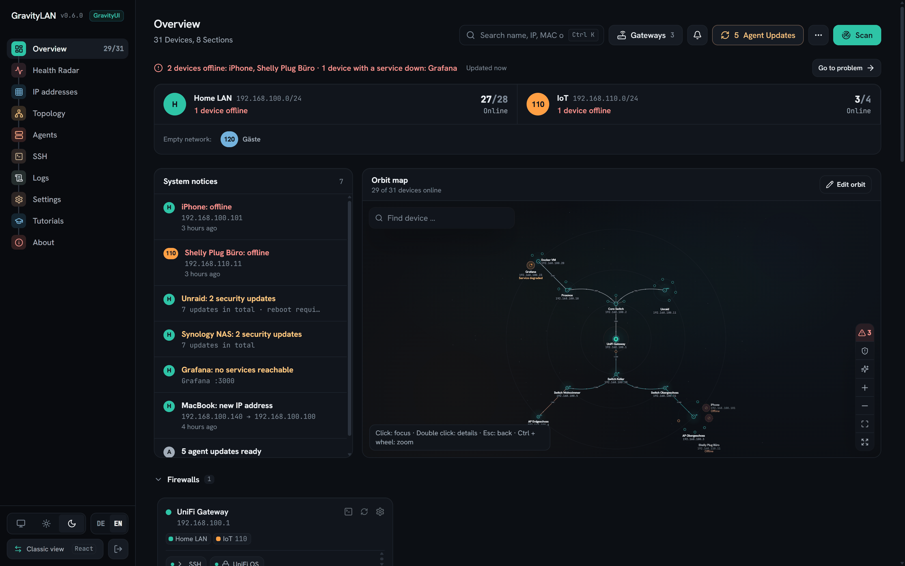
</p>

> [!NOTE]
> **Pre-release.** GravityLAN is in active development and features may change between versions. Export a backup (Settings → Backup & restore) before you upgrade.

<a id="english"></a>

## What it is

GravityLAN is a self-hosted dashboard for the network at home or in the lab. It sweeps your subnets, keeps every device it finds in one inventory, and lets you add what a scanner can't know: groups, racks and cabling, which VM runs on which host. Install the optional agent on your Linux machines and the same inventory shows their load, disks and temperatures, counts pending package updates and installs them on request.

You work with it in **GravityUI**, a web interface built on Vue 3 that shows the state of the network first: which device is down, which service fails, which switch would take others with it. It draws the network as an orbit map and your racks as hardware you mount and cable, and it works on a phone as well as on a wall monitor, in English and German, dark or light.

Everything runs in **one container** on **SQLite**: a FastAPI backend, the inventory in `gravitylan.db` and measurement data in a separate `telemetry.db`. It is built for a **trusted home network**, not for direct exposure to the internet. The original React interface still ships alongside as a fallback (see [Classic interface](#classic-interface-react)).

## GravityUI at a glance

All screenshots use the [demo data](#development): the homelab, and the small company network for the racks and the resilience view.

<table>
  <tr>
    <td width="50%" valign="top">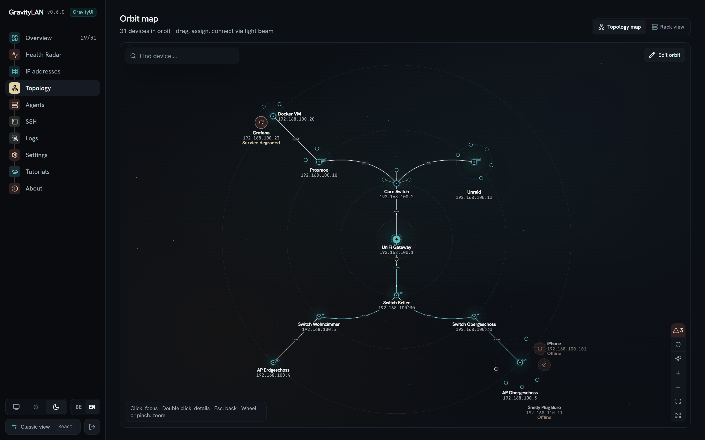<br><sub><b>Orbit map</b>: the topology as a solar system</sub></td>
    <td width="50%" valign="top">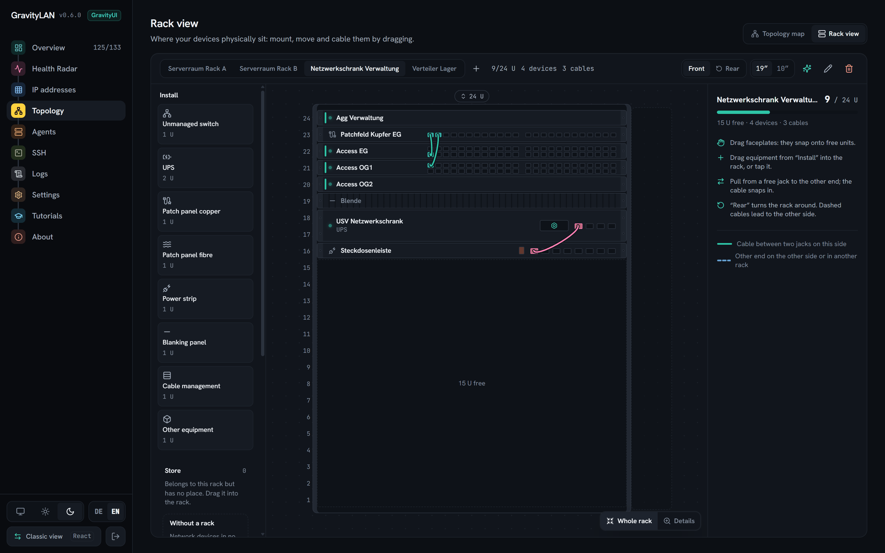<br><sub><b>Racks</b>: faceplates, ports and cables</sub></td>
  </tr>
  <tr>
    <td width="50%" valign="top">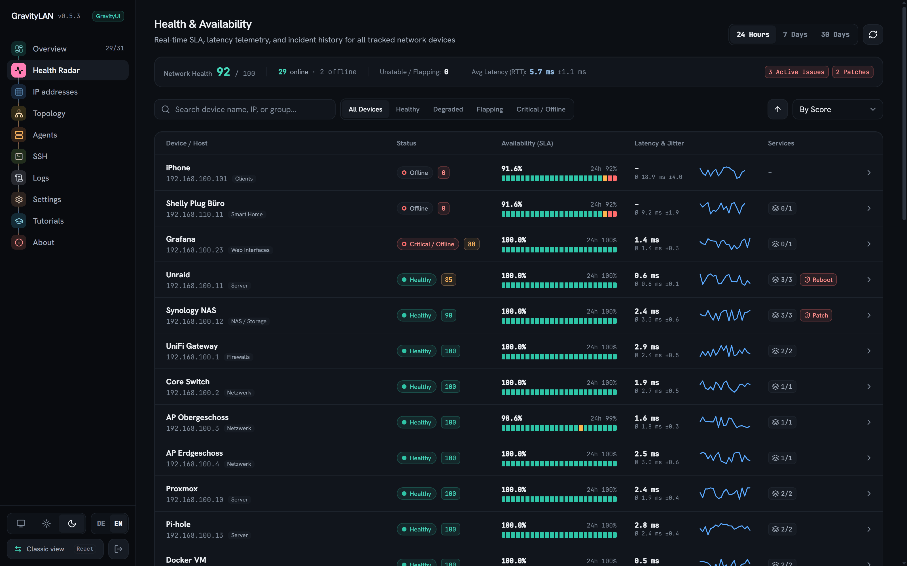<br><sub><b>Health Radar</b>: score, SLA, single points of failure</sub></td>
    <td width="50%" valign="top">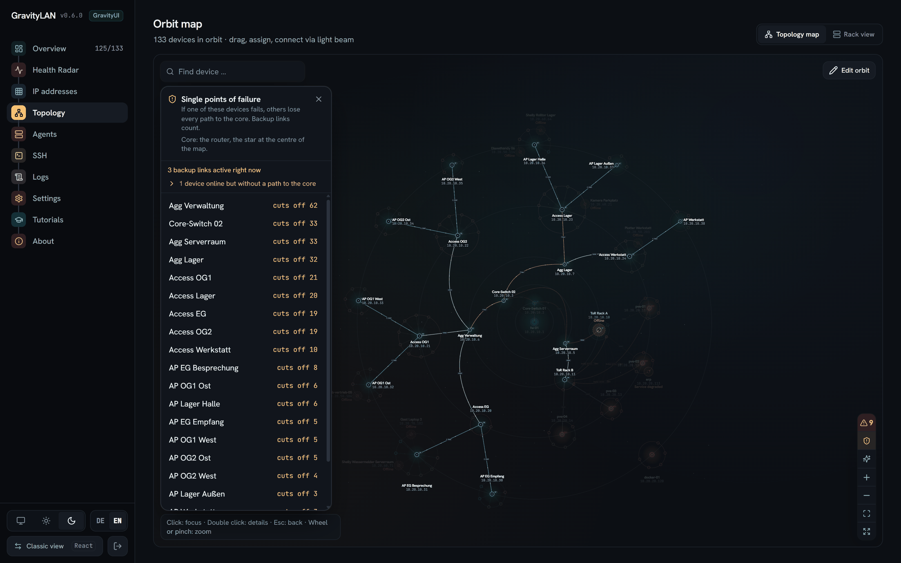<br><sub><b>Resilience</b>: what each device would cut off</sub></td>
  </tr>
  <tr>
    <td width="50%" valign="top">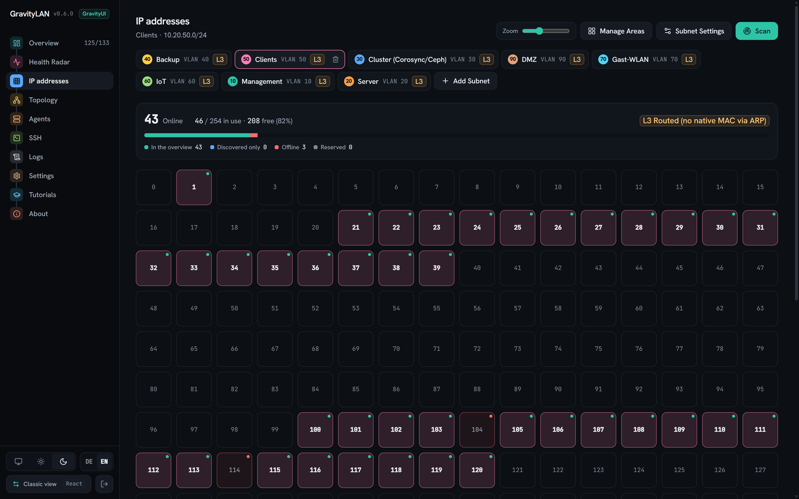<br><sub><b>IP addresses</b>: every address of a subnet</sub></td>
    <td width="50%" valign="top">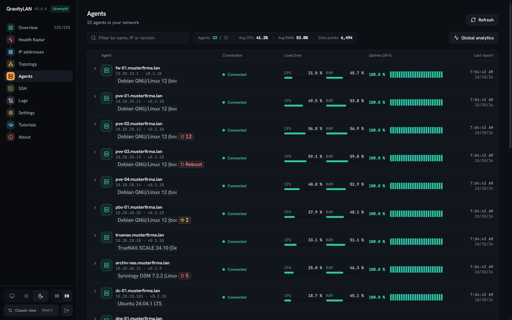<br><sub><b>Agents</b>: load, updates, uptime</sub></td>
  </tr>
  <tr>
    <td width="50%" valign="top">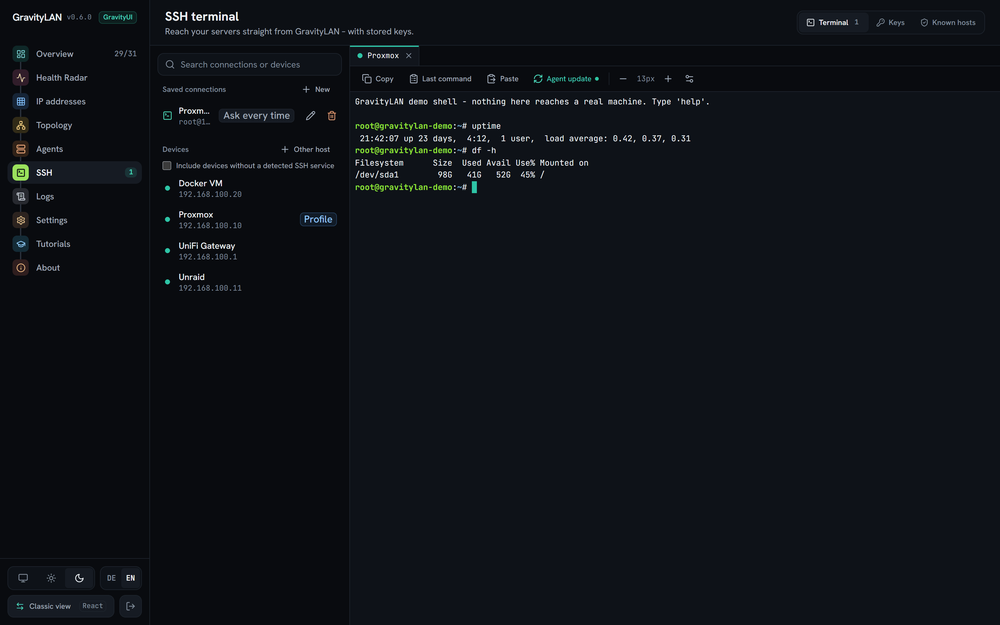<br><sub><b>SSH terminal</b>: tabs, saved connections, agent update</sub></td>
    <td width="50%" valign="top">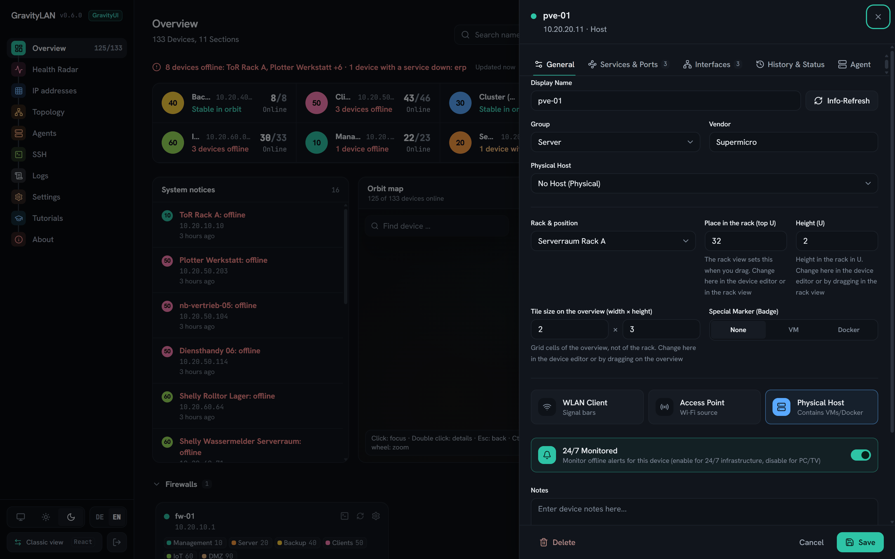<br><sub><b>Device editor</b>: group, host, rack position</sub></td>
  </tr>
  <tr>
    <td width="50%" valign="top">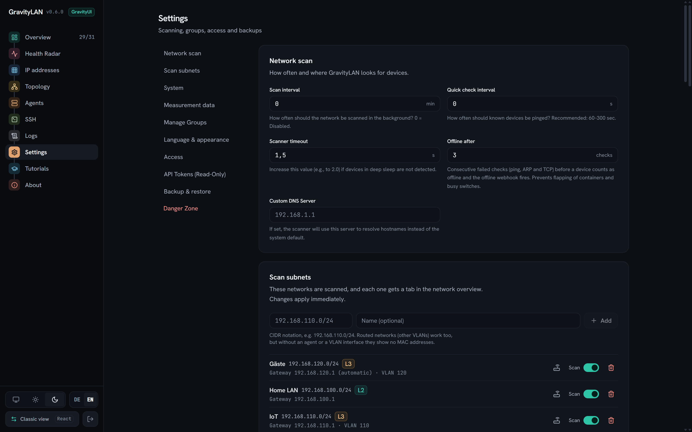<br><sub><b>Settings</b>: scan, subnets, appearance, access</sub></td>
    <td width="50%" valign="top">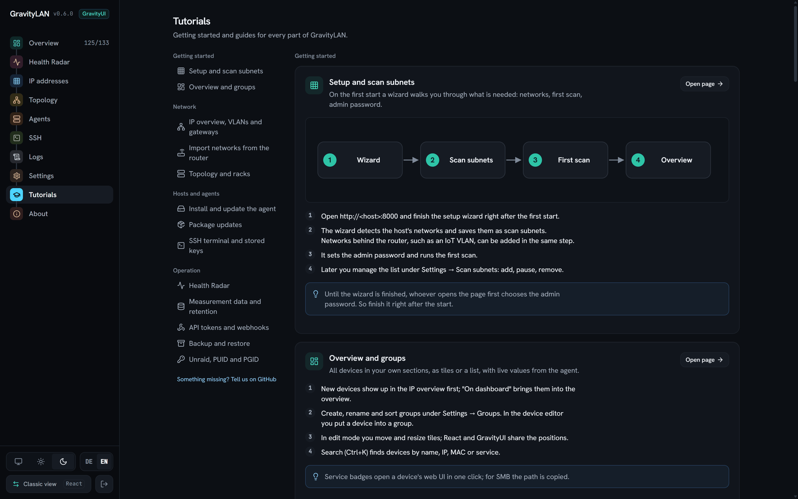<br><sub><b>Tutorials</b>: guides with steps and diagrams</sub></td>
  </tr>
</table>

<p align="center">
  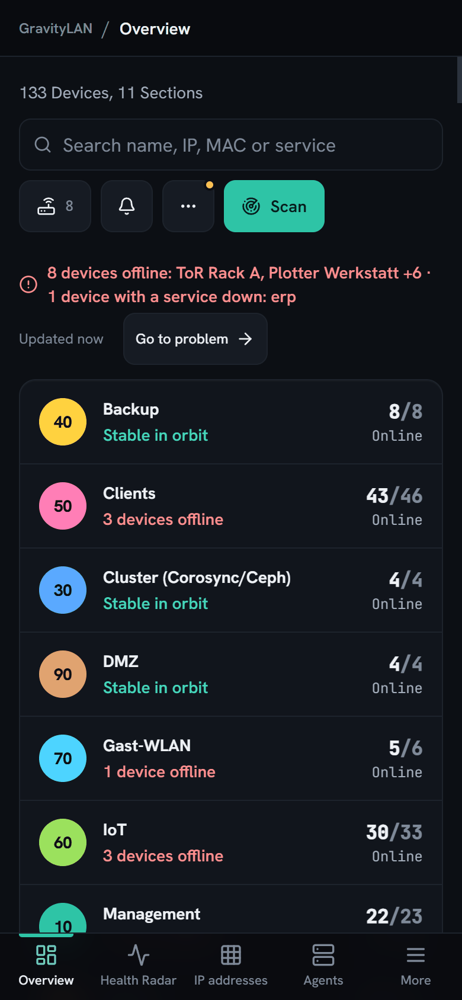
  &nbsp;&nbsp;
  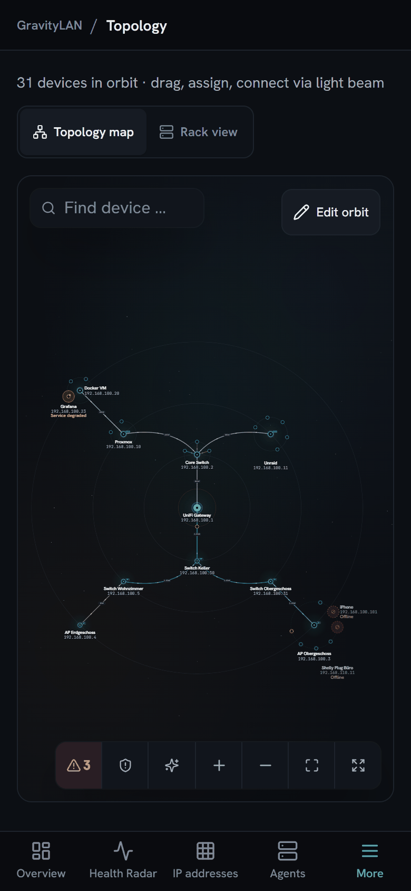
</p>

## Features

### In GravityUI

| Page | What you get |
|---|---|
| **Overview** | A status line first: "All good · 29 of 31 devices online", or which devices are offline or have a service down, how fresh that is, and **Go to problem**. Then one line per network with its devices online, system notices (devices and services down, security updates, new agent keys, IP changes, agent updates), the live orbit map, and your devices in your own groups, as tiles or a list, with live agent metrics and service links that open the web UI, copy the SMB path or download an RDP file. Search name, IP, MAC or service with `Ctrl+K`; gateways, notifications, scan, the Agent Update Center and layout editing sit in the toolbar. |
| **Orbit map** | The topology as a solar system: the router is the star, switches, access points and hosts are planets on its orbits, and endpoints, VMs and Wi-Fi clients circle their planet as moons. Links are light beams in the colour of their type (100 Mb to 10 GbE, Wi-Fi, fibre). Click to focus a device, trace the path between two devices hop by hop, search, zoom and pinch; a button jumps from one problem to the next. A link marked **Backup** stays thin and dashed until a device fails and it carries the traffic, then it lights up amber. The **Resilience** view lists the single points of failure and how many devices each one would cut off. In edit mode you draw links, move devices, choose each one's role and set a port limit. |
| **Racks** | Topology → Rack view. Faceplates that look like the hardware (switches with link LEDs, servers with drive bays, a UPS with its display, patch panels), each in its network's colour. Drag a faceplate onto free units, on a phone after a short hold, and pull in equipment that has no IP from **Install**: unmanaged switches, UPS units, copper and fibre patch panels, power strips, blanking panels, cable management. Give devices and equipment ports (RJ45, SFP, SFP+, LC, power, console) on the front or rear, and pull a cable from one free jack to another. Turn the rack around, change its height (1 to 60 U) and width (19 or 10 inch); every change can be undone from its toast. |
| **Health Radar** | A network score from availability, latency and jitter, flapping, SSL certificate expiry and pending security patches, over 24 hours, 7 or 30 days. An SLA table with uptime per time slice, latency and services, the network's single points of failure, incidents on a timeline, and per device a latency chart, SSL and agent health. Devices that aren't on 24/7 (laptops, TVs, phones) count as clients: asleep, they don't pull the score down. |
| **IP addresses** | A map of each subnet's address space: used, free, online, offline. A badge on every subnet shows how GravityLAN reaches it: **L2 Direct** on one of its own interfaces, **L3 Routed** through a router, or **L2 Probe** through an agent inside it. Every scan subnet has its own tab; a paused one stays there, greyed out. Each address opens a popover to reserve, monitor, rename, add, port-scan or refresh it; plus named areas, live discovery and recent findings. |
| **Agents** | Every agent with OS, pending and security updates, reboot and release-upgrade tags, live CPU and RAM and 24-hour uptime. A row opens its telemetry (CPU, RAM, temperature, disks) and its package updates: log in over SSH by password, key or stored key, review the packages and install security updates only or all of them, with live output. Changed agent keys are adopted here. |
| **SSH terminal** | Shells on your devices in the browser, also on phones: tabs that keep running while you use the rest of GravityLAN, saved and recent connections, host key check, copy, paste and "copy last command", fonts and colour schemes, and an **Agent update** button. Keys (OpenSSH, PEM, PuTTY `.ppk`) are stored encrypted on the server; known hosts are managed on the same page. |
| **Device editor** | Five tabs: general (name, group, physical host, rack and units, tile size, 24/7 monitoring, notes), services and ports, interfaces with merge suggestions, history and status with an availability monitor and timeline, and the agent (install, update, uninstall, configuration, Layer-2 probe). |
| **Logs** | The live backend log, split into time, level, logger and message, with a filter for warnings and errors, search, pause, copy and **Jump to newest**. It reconnects on its own after a backend restart. |
| **Settings** | Scan schedule, offline threshold and DNS server; the scan subnets (add, pause, remove, take a network detected on the host, import from the router); system (retention, log level, start page, default interface, server URL); measurement data; groups; language and appearance (theme, language, a colour per network and per link type); password, API tokens, backup and restore, database reset. |
| **Setup, Tutorials, About** | A setup wizard on first start. Thirteen tutorials with steps, examples and diagrams: setup and scan subnets, overview and groups, IP addresses and VLANs, router import, topology and racks, installing the agent, package updates, SSH, Health, measurement data, API tokens and webhooks, backup, Unraid. About shows the server and agent version, the MIT licence with third-party notices and the project links. |
| **Everywhere** | Dark (the default), light or the system's theme; English and German; on phones a bottom tab bar, 44 px touch targets and pinch-to-zoom; keyboard access and screen reader labels on the orbit map; animations stop when the system asks for reduced motion. |

### Underneath

| Area | What you get |
|---|---|
| **Discovery** | Scheduled Nmap and ARP scans of your scan subnets, plus a lighter presence check in between: hosts, open ports, services, hostnames (DNS, mDNS, NetBIOS) and vendors. Containers with their own LAN address are found too, also `ipvlan` setups where several of them share the host's MAC. A device only counts as offline after several failed checks in a row (ping, ARP and TCP; 3 by default), so busy hosts don't flap. |
| **Routed subnets & VLANs** | ARP stops at the router, so in a routed subnet a scan finds the hosts but not their MAC addresses, and GravityLAN won't hand the router's MAC (proxy ARP) to every host there. For the real MACs and vendors, let an agent in that subnet work as a [Layer-2 probe](#the-agent), or give the container an address in each VLAN with the [multi-VLAN compose variant](#quick-start). |
| **One router, many VLANs** | A router that is the gateway of several subnets stays one device: its address in each VLAN is an interface with its own online state, shown in every IP tab and as one body on the orbit map, with a colour chip per network. Each subnet can store its gateway and VLAN tag; the "Gateways" list on the overview shows them all, and duplicates are offered for merging as interfaces. |
| **Router import** | Settings → Scan subnets → Import from router reads the networks your router routes, with gateway, name and VLAN, and adds only the ones you pick. Read-only SNMP (v1/v2c/v3; OPNsense, pfSense, OpenWrt, MikroTik and most business routers) or the UniFi Network API with an API key. Credentials are stored encrypted. |
| **Linux agent** | One Python script per host, reporting CPU, RAM, disks, network and temperature (every 30 s by default) and pending package updates (apt, dnf, yum), which you install over SSH from the Agents page, also as a sudo user. Detects the OS and knows LXC containers and ZFS pools. |
| **Agent rollout** | Install or update agents over SSH (with a saved key connection or credentials you type in), with a one-line installer carrying a one-time code, for all outdated agents at once in the Agent Update Center, or straight from an open terminal. |
| **Measurement data** | Health probes and agent metrics live in their own `telemetry.db`, so they don't bloat the inventory or backups. Raw values are kept 48 h, then folded into hourly (30 days) and daily values (365 days); charts pick the right tier for the time window. Settings → Measurement data shows the sizes and clears old data per device or in full. |
| **API & integrations** | REST API with Swagger UI at `/docs`, a Python client ([`gravitylan_api`](gravitylan_api)), read-only API tokens (finer scopes through the API) and webhooks for `device.offline` and `scan.complete`. A read-only token is a good fit for [AI assistants and agents](#ai-assistants-and-agents). |
| **Backup & restore** | Export and import devices, groups, interfaces and settings as JSON. An import never touches the admin password, the master token or the setup state. |

## Quick start

```bash
docker run -d --name gravitylan \
  -p 8000:8000 \
  -v gravitylan-data:/app/data \
  -e PUID=1000 -e PGID=1000 \
  --cap-add=NET_RAW --cap-add=NET_ADMIN \
  --restart unless-stopped \
  sleeperxr/gravitylan:latest
```

Open `http://<your-host>:8000/frontend-vue/` and go through the setup wizard: it detects your subnets and saves them as scan subnets, runs the first scan and sets the admin password. Subnets the container can't see directly, such as an IoT VLAN behind the router, can be added in the same step. To make GravityUI what `http://<your-host>:8000` opens for everyone, choose it under **Settings → System → Default interface**.

> [!IMPORTANT]
> **Finish the setup wizard right after the first start.** Until then only the wizard's own routes answer, but whoever opens the page first chooses the admin password. The same applies after a factory reset.

**Docker Compose.** The repository has five variants; start one with `docker compose -f <file> up -d`:

- [`docker-compose.yml`](docker-compose.yml): bridge network on port 8000. The simplest start; ARP and MAC detection only see what the bridge passes through.
- [`docker-compose.hostnet.yml`](docker-compose.hostnet.yml): host network. The best view of the LAN (ARP, MAC addresses, multicast), with less isolation.
- [`docker-compose.macvlan.yml`](docker-compose.macvlan.yml): macvlan, so the container gets its own address in your LAN. Set `GRAVITYLAN_IP`, `GRAVITYLAN_SUBNET`, `GRAVITYLAN_GATEWAY` and `GRAVITYLAN_INTERFACE` for your network.
- [`docker-compose.multi-vlan.yml`](docker-compose.multi-vlan.yml): macvlan on 802.1Q-tagged VLAN interfaces, so the container gets its own address in each VLAN and sees real MAC addresses in all of them. The template has three (main, IoT, server); the host needs the VLAN interfaces (`eth0.10` …, on Unraid `br0.10` …). Set `VLAN_*_IFACE`, `VLAN_*_SUBNET`, `VLAN_*_GATEWAY` and `GRAVITYLAN_*_IP`. Guide: [docs/multi-vlan-setup.md](docs/multi-vlan-setup.md).
- [`docker-compose.unraid.yml`](docker-compose.unraid.yml): host network for Unraid; builds the image from a checkout of this repository.

**Data directory permissions.** The container starts as root only to prepare `/app/data`: it gives its internal user the IDs from `PUID` and `PGID` (default `1000`/`1000`, the Unraid template sets `99`/`100`), hands the data directory to that user and then starts the server as it. A fresh host directory that belongs to root works without `chown`; other mounts below `/app/data` are left alone. Started with `--user`, the container changes nothing and stops with a clear message if it can't write to the data directory.

**Unraid.** The template in [`templates/gravitylan.xml`](templates/gravitylan.xml) sets `PUID=99` and `PGID=100` (Unraid's `nobody:users`), keeps appdata under `/mnt/user/appdata/gravitylan` and needs no privileged mode: `NET_RAW` and `NET_ADMIN` are enough for scanning. It explains which network type to pick (host, or a custom `br0` network with its own address). More: [docs/unraid-template.md](docs/unraid-template.md).

The image is multi-stage (Vite builds of both interfaces, then a slim Python runtime) and the server runs as a non-root user; Nmap gets only the capabilities it needs. To build it yourself: `docker build -t gravitylan:local .`

## Classic interface (React)

GravityLAN started with a React interface, and the image still ships it. Until GravityUI takes over, the start address `/` opens the classic view unless you choose otherwise:

- **for everyone**: Settings → System → Default interface → GravityUI;
- **for this browser**: the switch at the bottom of the sidebar, or `/?ui=vue` and `/?ui=react`. The choice is kept in this browser, whatever the server default is.

GravityUI itself lives at `/frontend-vue/`. The classic view gets bug fixes only; new features go into GravityUI. Once GravityUI covers everything the classic view does, it becomes the default, the React interface stays for one more version as a fallback and is removed after that ([ADR-003](docs/adr/003-react-retirement.md)).

## The agent

The agent is optional: discovery, topology and the SSH terminal work without it. It is a single Python script that runs as a service on a Linux host and reports to GravityLAN with its own device token. It uses systemd where available, Synology's rc.d, a copy on the flash drive on Unraid (which runs from RAM), or a plain background start.

**Install** from the **Agent** tab of the device editor:

1. **Over SSH**: pick a saved key connection of the device or type in a user and password. Typed-in credentials are used for that request only and never stored. A saved key is decrypted on the GravityLAN server only, and only used for a host whose key you have confirmed in the SSH terminal.
2. **One-line installer**: copy the `curl … | sudo bash` command and run it on the host. It carries a one-time code (valid 30 minutes, usable once); "New code" makes a fresh one.

**Update.** When the server ships a newer agent, the overview shows how many hosts are behind. The **Agent Update Center** updates them together (each with its saved key connection, the rest with one user and password), an open SSH terminal offers an **Agent update** button that types the command into the shell for you to check and run, and the one-line installer works for updates too.

**Layer-2 probe.** In a subnet GravityLAN only reaches through a router, an agent can supply the MAC addresses. In the device editor's **Agent** tab, switch on **L2 Subnet Scanner (Probe)** under Agent Configuration and save; the agent picks it up with its next report. From then on it refreshes its ARP table once a minute (a quick sweep of its own subnets, up to 512 addresses each) and sends the MAC and IP pairs along with its metrics. GravityLAN only accepts addresses inside a scan subnet that also contains the probe's own address, so that subnet has to be in your scan subnets. It fills in MAC addresses and vendors of known devices, new hosts show up under Recent Findings, and the IP addresses page marks that subnet **L2 Probe (&lt;device&gt;)**. This needs agent 0.3.8 or newer; the sweep came with 0.3.9.

To uninstall, use the same tab (over SSH) or the uninstall one-liner next to the installer. More detail: [AGENT.md](AGENT.md).

## Python client

```bash
pip install ./gravitylan_api
```

```python
from gravitylan_api import GravityLANClient

client = GravityLANClient(base_url="http://gravitylan.local:8000", token="<API token>")
for device in client.devices.list():
    print(device["display_name"], device["ip"])
```

Create a token under **Settings → API Tokens (Read-Only)**. The client also reads `GRAVITYLAN_BASE_URL` and `GRAVITYLAN_TOKEN` from the environment and only needs `requests`.

## AI assistants and agents

The API is a good source for an AI assistant or agent (for example Hermes or Clawdbot) that should answer questions about your network: which devices are offline, what runs on a host, which services are down, how the topology looks. Give it a **read-only API token**, so it can look but not change anything.

1. Create a token under **Settings → API Tokens (Read-Only)**. It is shown once; store it in the assistant's secrets, not in a prompt.
2. Send it as a header with every request:

```bash
curl -s -H "Authorization: Bearer gl_pat_…" http://gravitylan.local:8000/api/devices
```

Useful read endpoints: `/api/devices` (inventory with status, services and agent metrics), `/api/summary`, `/api/health/summary`, `/api/topology/map` and `/api/network/subnets`. The full list with schemas is in Swagger UI at `/docs`, and agents written in Python can use [`gravitylan_api`](#python-client) instead of raw HTTP. `/api/auth/me` tells a token which scopes it has.

What a token from the Settings page can do: read devices, topology, networks, agent metrics, settings and scan results (the scopes `devices:read`, `topology:read`, `network:read`, `agent:read`, `settings:read`, `backup:read` and `scanner:read`). Finer scopes can be set when a token is created through `POST /api/auth/tokens`.

What it can't do, whatever the scopes:

- no SSH: terminals, saved keys and stored passwords are for logged-in browser sessions only;
- no agent configuration: downloading an agent's config, installing, adopting, uninstalling and package updates are blocked;
- no admin endpoints: no token management, no backup export, no database reset, and no changes without a write scope.

## Configuration

Most options live in the database and are changed in the setup wizard and on the Settings page. Environment variables (prefix `GRAVITYLAN_`, see [`backend/app/config.py`](backend/app/config.py)):

| Variable | Meaning | Default |
|---|---|---|
| `GRAVITYLAN_DATA_DIR` | Data directory (SQLite database, vault key) | `/app/data` |
| `GRAVITYLAN_DATABASE_URL` | Full SQLAlchemy URL, if you don't want SQLite in the data directory | empty |
| `GRAVITYLAN_PORT` / `GRAVITYLAN_HOST` | Listen port and address | `8000` / `0.0.0.0` |
| `GRAVITYLAN_DEBUG` | Verbose logging | `false` |
| `GRAVITYLAN_SECURE_COOKIES` | Mark the session cookie `Secure`; turn on behind HTTPS | `false` |
| `GRAVITYLAN_SSH_STRICT_MODE` | Refuse unknown SSH host keys when deploying agents or installing updates | `false` |
| `GRAVITYLAN_ALLOW_INSECURE_INSTALL` | Let the manual install command run over plain HTTP without `ALLOW_INSECURE=1` on the device (agent and token travel unencrypted) | `false` |
| `GRAVITYLAN_DOCKER_HOST_IP` | LAN IP of the machine running the container. Only SSH logins to this address may retry over the Docker bridge gateway (when the container can't reach its own host, e.g. with macvlan) | empty |
| `GRAVITYLAN_SSH_IDLE_TIMEOUT_MINUTES` | Close terminal sessions without input after N minutes (0 = never) | `30` |
| `GRAVITYLAN_SSH_MAX_SESSIONS` | Maximum number of open terminal sessions | `10` |
| `GRAVITYLAN_VAULT_KEY` | Key for the encrypted SSH key store; otherwise generated as `data/ssh_vault.key` | empty |
| `GRAVITYLAN_HISTORY_RETENTION_DAYS` | Keep metrics and history for N days (1 to 365) | `30` |
| `GRAVITYLAN_SCAN_TIMEOUT` | Port connect timeout per target, in seconds | `1.5` |
| `GRAVITYLAN_SCAN_WORKERS` | Scanner concurrency | `20` |
| `GRAVITYLAN_SCAN_INTERVAL_MINUTES` | Automatic scan interval (0 = off) | `0` |
| `GRAVITYLAN_CORS_ORIGINS` | Extra CORS origins (not needed for the bundled UI) | empty |

## Security and operation

GravityLAN assumes a **trusted home network**. For access from outside, use a VPN or your usual reverse proxy with HTTPS, and set `GRAVITYLAN_SECURE_COOKIES=true`. Over plain HTTP, terminal keystrokes cross the network unencrypted.

- **Login**: `httpOnly` session cookie, Argon2 password hashes. After 5 failed attempts within a minute from one address, logins are refused for the rest of that minute. Behind a reverse proxy on another machine, all attempts count against the proxy's address.
- **API tokens** are stored hashed and are read-only unless given other scopes; the scopes also apply to WebSocket connections, and downloading an agent's config needs `agent:write`. Each agent has its own token, stored as a SHA-256 hash as well, and an unknown agent has to be adopted on its device card.
- **Agent reports**: ARP neighbours are only accepted from devices with the Layer-2 probe switched on, and only inside the probe's own scan subnet, so one agent can't rewrite the MAC addresses or state of other devices.
- **SSH**: keys and stored passwords are encrypted on the server and never sent back to the browser. Only logged-in browser sessions can open shells or use saved keys, not API or master tokens. A host whose key changed is blocked until you remove the old entry; package updates also remember a host's key on first contact and refuse a different one later. Details: [ADR 002](docs/adr/002-ssh-keystore.md).
- **Agent install**: the agent's config is readable by root only, its service runs with a private `/tmp` and read-only home directories, and install codes are masked in the request log. The server URL written into the installer has to be a plain `http(s)://host[:port][/path]`.
- **Webhooks** can't target the GravityLAN host itself, link-local addresses or cloud metadata services; the target is checked again before every delivery. LAN addresses work.
- **Backups** don't contain SSH keys, stored passwords or agent tokens, and importing one never replaces the admin password, the master token or the setup state. Keep `data/ssh_vault.key` (or `GRAVITYLAN_VAULT_KEY`) safe on its own: without it, stored keys can't be decrypted.

More: [SECURITY.md](SECURITY.md) · [Threat model](docs/threat-model.md) · [Container hardening](docs/container-hardening.md) · [Security baseline](docs/security-baseline.md)

## Architecture

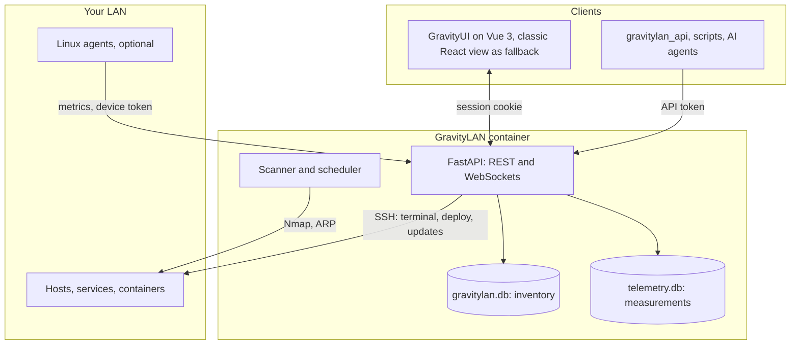

Architecture decisions are recorded in [docs/adr/](docs/adr).

## Development

**Windows:** `.\start_gravitylan.ps1` installs the dependencies and starts Uvicorn on `:8000`, GravityUI on `:5174` and the classic view on `:5173`.

**Linux and macOS:**

```bash
# Backend (Python 3.12+, Nmap installed)
cd backend
pip install -r requirements.txt
python -m uvicorn app.main:app --reload --host 0.0.0.0 --port 8000

# GravityUI (Node 20+), in a second terminal: http://localhost:5174/frontend-vue/, proxies /api to :8000
cd frontend-vue
npm install
npm run dev

# Classic view, optional, on :5173
cd frontend
npm install
npm run dev
```

GravityUI takes its API client, types and texts from `frontend/src`, so `frontend/` has to stay next to it even when you only work on GravityUI.

**Without touching your network:** `python scripts/dev_demo.py` (in the backend virtualenv) starts the API on `127.0.0.1:8000` with a throw-away demo database, simulated agents with 24 hours of history and a fake SSH shell, but no scans. Start GravityUI as above and log in with `demo`. `--reset` seeds the demo data again, `--fresh` starts like a new install, `--company` loads a small company network instead (8 VLANs, a four-node Proxmox cluster, about 130 devices, four racks with ports and cables, backup links, own database). The screenshots in this README come from it.

**Tests and checks:**

```bash
cd frontend-vue && npm test && npm run typecheck && npm run lint   # GravityUI (Vitest, vue-tsc, ESLint)
cd backend && python -m pytest                                    # backend
python -m pytest gravitylan_api/tests                             # Python client, from the repository root
cd frontend && npm test && npm run typecheck                      # classic view
```

**Repository layout:**

```
agent/            Linux agent (gravitylan-agent.py) and systemd unit
backend/app/      FastAPI app: api/, models/, schemas/, scanner/, services/, database/
backend/tests/    Backend tests (pytest)
frontend-vue/     GravityUI (Vue 3, Vite, Tailwind, Pinia); design system in DESIGN.md
frontend/         Classic React interface (fallback); src/ also holds the API client, types and texts GravityUI uses
gravitylan_api/   Python client
docs/             Security and design docs, ADRs, screenshots (vue/, react/)
scripts/          Demo backend and maintenance scripts
templates/        Unraid template
```

Contributions are welcome: see [CONTRIBUTING.md](CONTRIBUTING.md). Interface work goes into `frontend-vue/`. What changed in each version: [CHANGELOG.md](CHANGELOG.md).

## License

[MIT](LICENSE). Built with Antigravity and maybe a little too much fun with the UI by **SleeperXr**.

---

## Deutsch

### Worum es geht

GravityLAN ist ein selbst gehostetes Dashboard fürs Heim- oder Labornetz. Es durchsucht deine Subnetze, führt jedes gefundene Gerät in einem Inventar und lässt dich ergänzen, was ein Scanner nicht wissen kann: Gruppen, Racks und Verkabelung, welche VM auf welchem Host läuft. Mit dem optionalen Agenten auf deinen Linux-Rechnern zeigt dasselbe Inventar deren Auslastung, Laufwerke und Temperaturen, zählt offene Paket-Updates und spielt sie auf Wunsch ein.

Bedient wird es über **GravityUI**, eine Weboberfläche auf Basis von Vue 3, die zuerst den Zustand des Netzes zeigt: welches Gerät ausgefallen ist, welcher Dienst hakt, welcher Switch andere mitreißen würde. Sie zeichnet das Netz als Orbit-Netzplan und deine Racks als Hardware, die du einbaust und verkabelst, und funktioniert am Handy genauso wie am Wandmonitor, auf Deutsch und Englisch, dunkel oder hell.

Alles läuft in **einem Container** auf **SQLite**: ein FastAPI-Backend, das Inventar in `gravitylan.db` und die Messdaten in einer eigenen `telemetry.db`. GravityLAN ist für ein **vertrauenswürdiges Heimnetz** gebaut, nicht für den direkten Betrieb im Internet. Die ursprüngliche React-Oberfläche liegt noch als Rückfallebene bei (siehe [Klassische Oberfläche](#klassische-oberfläche-react)).

### GravityUI im Überblick

Alle Screenshots zeigen die [Demo-Daten](#entwicklung): das Homelab, für die Racks und die Ausfallsicherheit das kleine Firmennetz.

<table>
  <tr>
    <td width="50%" valign="top"><br><sub><b>Orbit-Netzplan</b>: die Topologie als Sonnensystem</sub></td>
    <td width="50%" valign="top"><br><sub><b>Racks</b>: Frontblenden, Ports und Kabel</sub></td>
  </tr>
  <tr>
    <td width="50%" valign="top"><br><sub><b>Health-Radar</b>: Score, SLA, Single Points of Failure</sub></td>
    <td width="50%" valign="top"><br><sub><b>Ausfallsicherheit</b>: was jedes Gerät mitreißen würde</sub></td>
  </tr>
  <tr>
    <td width="50%" valign="top"><br><sub><b>IP-Adressen</b>: jede Adresse eines Subnetzes</sub></td>
    <td width="50%" valign="top"><br><sub><b>Agents</b>: Last, Updates, Verfügbarkeit</sub></td>
  </tr>
  <tr>
    <td width="50%" valign="top"><br><sub><b>SSH-Terminal</b>: Tabs, Verbindungen, Agent-Update</sub></td>
    <td width="50%" valign="top"><br><sub><b>Geräte-Editor</b>: Gruppe, Host, Rack-Position</sub></td>
  </tr>
  <tr>
    <td width="50%" valign="top"><br><sub><b>Einstellungen</b>: Scan, Subnetze, Darstellung, Zugang</sub></td>
    <td width="50%" valign="top"><br><sub><b>Tutorials</b>: Anleitungen mit Schritten und Diagrammen</sub></td>
  </tr>
</table>

<p align="center">
  
  &nbsp;&nbsp;
  
</p>

### Funktionen

#### In GravityUI

| Seite | Was du bekommst |
|---|---|
| **Übersicht** | Zuerst eine Statuszeile: „Alles in Ordnung · 29 von 31 Geräten online“ oder welche Geräte offline sind oder einen ausgefallenen Dienst haben, wie aktuell das ist, und **Zum Problem**. Darunter eine Zeile pro Netz mit den Geräten online, Systemhinweise (ausgefallene Geräte und Dienste, Sicherheits-Updates, neue Agent-Keys, IP-Wechsel, Agent-Updates), der Live-Orbit-Netzplan und deine Geräte in eigenen Gruppen, als Kacheln oder Liste, mit Live-Werten vom Agenten und Dienst-Links, die die Weboberfläche öffnen, den SMB-Pfad kopieren oder eine RDP-Datei laden. Suche nach Name, IP, MAC oder Dienst mit `Strg+K`; Gateways, Benachrichtigungen, Scan, das Agent-Update-Center und das Bearbeiten des Layouts sitzen in der Werkzeugleiste. |
| **Orbit-Netzplan** | Die Topologie als Sonnensystem: Der Router ist der Stern, Switches, Access Points und Hosts sind Planeten auf seinen Umlaufbahnen, Endgeräte, VMs und WLAN-Clients kreisen als Monde um ihren Planeten. Verbindungen sind Lichtstrahlen in der Farbe ihres Typs (100 Mb bis 10 GbE, WLAN, Glasfaser). Klick fokussiert ein Gerät; den Weg zwischen zwei Geräten verfolgen, Hop für Hop; suchen, zoomen, mit zwei Fingern ziehen; eine Schaltfläche springt von Problem zu Problem. Eine Verbindung mit der Rolle **Backup** bleibt dünn und gestrichelt, bis ein Gerät ausfällt und sie den Verkehr übernimmt, dann leuchtet sie bernsteinfarben. Die Ansicht **Ausfallsicherheit** listet die Single Points of Failure und wie viele Geräte jeder abschneiden würde. Im Bearbeitungsmodus ziehst du Verbindungen, verschiebst Geräte, wählst ihre Rolle und setzt ein Port-Limit. |
| **Racks** | Topologie → Rack-Ansicht. Frontblenden, die wie die Hardware aussehen (Switches mit Link-LEDs, Server mit Laufwerksschächten, eine USV mit Display, Patchfelder), jeweils in der Farbe ihres Netzes. Eine Blende auf freie Höheneinheiten ziehen, am Handy nach kurzem Halten, und Ausstattung ohne IP aus **Einbauen** hereinziehen: unmanaged Switches, USVs, Kupfer- und Glasfaser-Patchfelder, Steckdosenleisten, Blindblenden, Kabelführungen. Geräten und Ausstattung Ports geben (RJ45, SFP, SFP+, LC, Strom, Konsole), vorne oder hinten, und ein Kabel von einer freien Buchse zur anderen ziehen. Das Rack umdrehen, Höhe (1 bis 60 HE) und Breite (19 oder 10 Zoll) ändern; jede Änderung lässt sich in ihrem Toast rückgängig machen. |
| **Health-Radar** | Ein Netzwerk-Score aus Verfügbarkeit, Latenz und Jitter, flackernden Verbindungen, Ablauf von SSL-Zertifikaten und offenen Sicherheits-Patches, über 24 Stunden, 7 oder 30 Tage. Eine SLA-Tabelle mit Verfügbarkeit pro Zeitabschnitt, Latenz und Diensten, die Single Points of Failure des Netzes, Vorfälle auf einer Zeitleiste und pro Gerät ein Latenzdiagramm, SSL und Agent-Zustand. Geräte, die nicht rund um die Uhr laufen (Laptops, Fernseher, Handys), zählen als Clients: Im Standby ziehen sie den Score nicht herunter. |
| **IP-Adressen** | Eine Karte des Adressraums jedes Subnetzes: belegt, frei, online, offline. Ein Badge an jedem Subnetz zeigt, wie GravityLAN es erreicht: **L2 Direkt** über eine eigene Schnittstelle, **L3 Geroutet** über einen Router oder **L2 Probe** über einen Agenten darin. Jedes Scan-Subnetz hat einen eigenen Reiter; ein pausiertes bleibt ausgegraut stehen. Jede Adresse öffnet ein Popover zum Reservieren, Überwachen, Umbenennen, Hinzufügen, Port-Scannen oder Auffrischen; dazu benannte Bereiche, Live-Erkennung und aktuelle Funde. |
| **Agents** | Jeder Agent mit Betriebssystem, offenen und Sicherheits-Updates, Hinweisen auf Neustart und Release-Upgrade, Live-CPU und -RAM und 24-Stunden-Verfügbarkeit. Eine Zeile öffnet seine Telemetrie (CPU, RAM, Temperatur, Laufwerke) und seine Paket-Updates: per SSH anmelden mit Passwort, Key oder gespeichertem Key, Pakete prüfen und nur Sicherheits-Updates oder alle einspielen, mit Live-Ausgabe. Geänderte Agent-Keys werden hier übernommen. |
| **SSH-Terminal** | Shells auf deine Geräte im Browser, auch am Handy: Tabs, die weiterlaufen, während du den Rest von GravityLAN nutzt, gespeicherte und zuletzt genutzte Verbindungen, Host-Key-Prüfung, Kopieren, Einfügen und „Letzten Befehl kopieren“, Schriften und Farbschemata und eine Schaltfläche **Agent-Update**. Keys (OpenSSH, PEM, PuTTY `.ppk`) liegen verschlüsselt auf dem Server; bekannte Hosts verwaltest du auf derselben Seite. |
| **Geräte-Editor** | Fünf Tabs: Allgemein (Name, Gruppe, physischer Host, Rack und Höheneinheiten, Kachelgröße, 24/7-Überwachung, Notizen), Dienste und Ports, Schnittstellen mit Vorschlägen zum Zusammenführen, Verlauf und Status mit Verfügbarkeitsmonitor und Zeitleiste sowie der Agent (installieren, aktualisieren, deinstallieren, Konfiguration, Layer-2-Probe). |
| **Logs** | Das Live-Log des Backends, aufgeteilt in Zeit, Level, Logger und Meldung, mit Filter für Warnungen und Fehler, Suche, Pause, Kopieren und **Zu den neuesten**. Nach einem Neustart des Backends verbindet es sich von selbst wieder. |
| **Einstellungen** | Scan-Zeitplan, Offline-Schwelle und DNS-Server; die Scan-Subnetze (hinzufügen, pausieren, entfernen, ein auf dem Host erkanntes Netz übernehmen, vom Router importieren); System (Aufbewahrung, Log-Level, Startseite, Standard-Oberfläche, Server-URL); Messdaten; Gruppen; Sprache und Darstellung (Theme, Sprache, eine Farbe pro Netz und pro Verbindungstyp); Passwort, API-Token, Backup und Wiederherstellung, Datenbank-Reset. |
| **Einrichtung, Tutorials, Über** | Ein Setup-Wizard beim ersten Start. Dreizehn Tutorials mit Schritten, Beispielen und Diagrammen: Einrichtung und Scan-Subnetze, Übersicht und Gruppen, IP-Adressen und VLANs, Router-Import, Topologie und Racks, Agent installieren, Paket-Updates, SSH, Health, Messdaten, API-Token und Webhooks, Backup, Unraid. „Über“ zeigt Server- und Agent-Version, die MIT-Lizenz mit Hinweisen zu Drittanbietern und die Projekt-Links. |
| **Überall** | Dunkel (Standard), hell oder wie das System; Deutsch und Englisch; am Handy eine Tab-Leiste unten, 44-px-Bedienelemente und Zoomen mit zwei Fingern; Tastaturbedienung und Screenreader-Beschriftungen im Orbit-Netzplan; Animationen halten an, wenn das System reduzierte Bewegung wünscht. |

#### Darunter

| Bereich | Was du bekommst |
|---|---|
| **Erkennung** | Geplante Nmap- und ARP-Scans deiner Scan-Subnetze, dazwischen ein leichterer Anwesenheits-Check: Hosts, offene Ports, Dienste, Hostnamen (DNS, mDNS, NetBIOS) und Hersteller. Auch Container mit eigener LAN-Adresse werden gefunden, ebenso `ipvlan`-Setups, in denen sich mehrere die MAC des Hosts teilen. Offline gilt ein Gerät erst nach mehreren Fehlversuchen in Folge (Ping, ARP und TCP; standardmäßig 3), damit ausgelastete Hosts nicht flackern. |
| **Geroutete Subnetze & VLANs** | ARP endet am Router, deshalb findet ein Scan in einem gerouteten Subnetz zwar die Hosts, aber nicht ihre MAC-Adressen, und die MAC des Routers (Proxy-ARP) überträgt GravityLAN dort nicht auf jeden Host. Für die echten MACs und Hersteller lass einen Agenten in diesem Subnetz als [Layer-2-Probe](#der-agent) arbeiten oder gib dem Container mit der [Multi-VLAN-Compose-Variante](#schnellstart) eine Adresse in jedem VLAN. |
| **Ein Router, viele VLANs** | Ein Router, der Gateway mehrerer Subnetze ist, bleibt ein Gerät: Seine Adresse in jedem VLAN ist eine Schnittstelle mit eigenem Online-Status, sichtbar in jedem IP-Reiter und als ein Himmelskörper im Orbit-Netzplan, mit einem Farb-Chip pro Netz. Jedes Subnetz kann sein Gateway und seinen VLAN-Tag speichern; die Liste „Gateways“ in der Übersicht zeigt alle, Doppelte werden zum Zusammenführen als Schnittstelle angeboten. |
| **Router-Import** | Einstellungen → Scan-Subnetze → Vom Router importieren liest die Netze, die dein Router routet, mit Gateway, Name und VLAN, und übernimmt nur die ausgewählten. Schreibgeschütztes SNMP (v1/v2c/v3; OPNsense, pfSense, OpenWrt, MikroTik und die meisten Business-Router) oder die UniFi Network API mit API-Key. Zugangsdaten liegen verschlüsselt. |
| **Linux-Agent** | Ein Python-Skript pro Host, das CPU, RAM, Laufwerke, Netzwerk und Temperatur meldet (standardmäßig alle 30 s) und offene Paket-Updates (apt, dnf, yum), die du per SSH aus der Agents-Seite einspielst, auch mit einem sudo-Benutzer. Erkennt das Betriebssystem und kennt LXC-Container und ZFS-Pools. |
| **Agent-Verteilung** | Agenten per SSH installieren oder aktualisieren (mit gespeicherter Key-Verbindung oder eingegebenen Zugangsdaten), per Einzeiler mit Einmal-Code, alle veralteten auf einmal im Agent-Update-Center oder direkt aus einem offenen Terminal. |
| **Messdaten** | Health-Proben und Agent-Metriken liegen in einer eigenen `telemetry.db` und blähen weder Inventar noch Backups auf. Rohwerte bleiben 48 Stunden, danach werden sie zu Stundenwerten (30 Tage) und Tageswerten (365 Tage) verdichtet; Diagramme wählen die passende Stufe zum Zeitraum. Einstellungen → Messdaten zeigt die Größen und löscht alte Daten pro Gerät oder komplett. |
| **API & Integrationen** | REST-API mit Swagger UI unter `/docs`, ein Python-Client ([`gravitylan_api`](gravitylan_api)), schreibgeschützte API-Token (feinere Scopes über die API) und Webhooks für `device.offline` und `scan.complete`. Ein schreibgeschütztes Token eignet sich gut für [KI-Assistenten und Agenten](#ki-assistenten-und-agenten). |
| **Backup & Wiederherstellung** | Geräte, Gruppen, Schnittstellen und Einstellungen als JSON exportieren und importieren. Ein Import ändert nie Admin-Passwort, Master-Token oder Setup-Status. |

### Schnellstart

```bash
docker run -d --name gravitylan \
  -p 8000:8000 \
  -v gravitylan-data:/app/data \
  -e PUID=1000 -e PGID=1000 \
  --cap-add=NET_RAW --cap-add=NET_ADMIN \
  --restart unless-stopped \
  sleeperxr/gravitylan:latest
```

`http://<dein-host>:8000/frontend-vue/` öffnen und den Setup-Wizard durchgehen: Er erkennt deine Subnetze und speichert sie als Scan-Subnetze, startet den ersten Scan und legt das Admin-Passwort fest. Subnetze, die der Container nicht direkt sieht, etwa ein IoT-VLAN hinter dem Router, lassen sich im selben Schritt ergänzen. Damit `http://<dein-host>:8000` für alle GravityUI öffnet, unter **Einstellungen → System → Standard-Oberfläche** auswählen.

> [!IMPORTANT]
> **Schließ den Setup-Wizard direkt nach dem ersten Start ab.** Bis dahin antworten nur die Routen des Wizards, aber wer die Seite zuerst öffnet, wählt das Admin-Passwort. Das gilt genauso nach einem Werksreset.

**Docker Compose.** Im Repository liegen fünf Varianten; starten mit `docker compose -f <datei> up -d`:

- [`docker-compose.yml`](docker-compose.yml): Bridge-Netzwerk auf Port 8000. Der einfachste Start; ARP- und MAC-Erkennung sehen nur, was die Bridge durchreicht.
- [`docker-compose.hostnet.yml`](docker-compose.hostnet.yml): Host-Netzwerk. Die beste Sicht aufs LAN (ARP, MAC-Adressen, Multicast), dafür weniger Isolation.
- [`docker-compose.macvlan.yml`](docker-compose.macvlan.yml): Macvlan, der Container bekommt eine eigene Adresse im LAN. `GRAVITYLAN_IP`, `GRAVITYLAN_SUBNET`, `GRAVITYLAN_GATEWAY` und `GRAVITYLAN_INTERFACE` an dein Netz anpassen.
- [`docker-compose.multi-vlan.yml`](docker-compose.multi-vlan.yml): Macvlan auf 802.1Q-getaggten VLAN-Schnittstellen, der Container bekommt in jedem VLAN eine eigene Adresse und sieht überall echte MAC-Adressen. Die Vorlage hat drei (Main, IoT, Server); der Host braucht die VLAN-Schnittstellen (`eth0.10` …, auf Unraid `br0.10` …). `VLAN_*_IFACE`, `VLAN_*_SUBNET`, `VLAN_*_GATEWAY` und `GRAVITYLAN_*_IP` anpassen. Anleitung: [docs/multi-vlan-setup.md](docs/multi-vlan-setup.md#deutsch).
- [`docker-compose.unraid.yml`](docker-compose.unraid.yml): Host-Netzwerk für Unraid; baut das Image aus einem Checkout dieses Repositorys.

**Rechte im Datenordner.** Der Container startet nur als root, um `/app/data` vorzubereiten: Er gibt seinem internen Benutzer die IDs aus `PUID` und `PGID` (Standard `1000`/`1000`, die Unraid-Vorlage setzt `99`/`100`), übergibt ihm den Datenordner und startet dann den Server als dieser Benutzer. Ein frischer Host-Ordner, der root gehört, funktioniert so ohne `chown`; andere Mounts unterhalb von `/app/data` bleiben unberührt. Mit `--user` gestartet, ändert der Container nichts und bricht mit einer klaren Meldung ab, wenn er nicht in den Datenordner schreiben kann.

**Unraid.** Die Vorlage [`templates/gravitylan.xml`](templates/gravitylan.xml) setzt `PUID=99` und `PGID=100` (Unraids `nobody:users`), legt die Daten unter `/mnt/user/appdata/gravitylan` ab und braucht keinen Privileged-Modus: `NET_RAW` und `NET_ADMIN` reichen zum Scannen. Sie erklärt, welcher Netzwerktyp passt (Host oder ein eigenes `br0`-Netz mit eigener Adresse). Mehr: [docs/unraid-template.md](docs/unraid-template.md).

Das Image ist mehrstufig gebaut (Vite-Builds beider Oberflächen, dann eine schlanke Python-Laufzeit), und der Server läuft als Nicht-root-Benutzer; Nmap bekommt nur die Capabilities, die es braucht. Selbst bauen: `docker build -t gravitylan:local .`

### Klassische Oberfläche (React)

GravityLAN hat mit einer React-Oberfläche angefangen, und das Image bringt sie noch mit. Bis GravityUI übernimmt, öffnet die Startadresse `/` die klassische Ansicht, solange du nichts anderes wählst:

- **für alle**: Einstellungen → System → Standard-Oberfläche → GravityUI;
- **für diesen Browser**: der Umschalter unten in der Seitenleiste oder `/?ui=vue` und `/?ui=react`. Die Wahl bleibt in diesem Browser, egal was der Server vorgibt.

GravityUI selbst liegt unter `/frontend-vue/`. Die klassische Ansicht bekommt nur noch Fehlerbehebungen, neue Funktionen kommen in GravityUI. Sobald GravityUI alles abdeckt, was die klassische Ansicht kann, wird sie Standard; die React-Oberfläche bleibt noch eine Version als Rückfallebene und wird danach entfernt ([ADR-003](docs/adr/003-react-retirement.md)).

### Der Agent

Der Agent ist optional: Erkennung, Topologie und SSH-Terminal funktionieren ohne ihn. Er ist ein einzelnes Python-Skript, das als Dienst auf einem Linux-Host läuft und sich mit einem eigenen Geräte-Token bei GravityLAN meldet. Er nutzt systemd, wo vorhanden, Synologys rc.d, auf Unraid (läuft aus dem RAM) eine Kopie auf dem USB-Stick oder einen einfachen Hintergrundstart.

**Installieren** im **Agent**-Tab des Geräte-Editors:

1. **Per SSH**: eine gespeicherte Key-Verbindung des Geräts wählen oder Benutzer und Passwort eingeben. Eingegebene Zugangsdaten gelten nur für diese Anfrage und werden nie gespeichert. Ein gespeicherter Key wird nur auf dem GravityLAN-Server entschlüsselt und nur für einen Host verwendet, dessen Host-Key du im SSH-Terminal bestätigt hast.
2. **Einzeiler**: den Befehl `curl … | sudo bash` kopieren und auf dem Host ausführen. Er enthält einen Einmal-Code (30 Minuten gültig, nur einmal nutzbar); „Neuer Code“ erzeugt einen frischen.

**Aktualisieren.** Bringt der Server einen neueren Agenten mit, zeigt die Übersicht, wie viele Hosts zurückliegen. Das **Agent-Update-Center** aktualisiert sie gemeinsam (jeden mit seiner gespeicherten Key-Verbindung, die übrigen mit einem Benutzer und Passwort), ein offenes SSH-Terminal bietet die Schaltfläche **Agent-Update**, die den Befehl zum Prüfen und Ausführen in die Shell schreibt, und auch der Einzeiler funktioniert für Updates.

**Layer-2-Probe.** In einem Subnetz, das GravityLAN nur über einen Router erreicht, kann ein Agent die MAC-Adressen liefern. Im **Agent**-Tab des Geräte-Editors unter Agent-Konfiguration **L2 Subnetz-Scanner (Probe)** einschalten und speichern; der Agent übernimmt das mit seiner nächsten Meldung. Danach frischt er einmal pro Minute seine ARP-Tabelle auf (ein kurzer Durchlauf durch seine eigenen Subnetze, bis 512 Adressen je Subnetz) und schickt die MAC-IP-Paare mit seinen Metriken mit. GravityLAN nimmt nur Adressen in einem Scan-Subnetz an, das auch die Adresse der Probe enthält; dieses Subnetz muss also in deinen Scan-Subnetzen stehen. Es ergänzt MAC-Adressen und Hersteller bekannter Geräte, neue Hosts erscheinen unter „Aktuelle Funde“, und die Seite IP-Adressen markiert das Subnetz mit **L2 Probe (&lt;Gerät&gt;)**. Das braucht Agent 0.3.8 oder neuer; den Durchlauf gibt es seit 0.3.9.

Deinstallieren geht im selben Tab (per SSH) oder mit dem Deinstallations-Einzeiler neben dem Installer. Mehr dazu: [AGENT.md](AGENT.md).

### Python-Client

```bash
pip install ./gravitylan_api
```

```python
from gravitylan_api import GravityLANClient

client = GravityLANClient(base_url="http://gravitylan.local:8000", token="<API-Token>")
for device in client.devices.list():
    print(device["display_name"], device["ip"])
```

Ein Token erstellst du unter **Einstellungen → API-Token (Read-Only)**. Der Client liest außerdem `GRAVITYLAN_BASE_URL` und `GRAVITYLAN_TOKEN` aus der Umgebung und braucht nur `requests`.

### KI-Assistenten und Agenten

Die API ist eine gute Quelle für einen KI-Assistenten oder Agenten (etwa Hermes oder Clawdbot), der Fragen zu deinem Netz beantworten soll: Welche Geräte sind offline, was läuft auf einem Host, welche Dienste sind ausgefallen, wie sieht die Topologie aus. Gib ihm ein **schreibgeschütztes API-Token**; damit kann er nachsehen, aber nichts ändern.

1. Token unter **Einstellungen → API-Token (Read-Only)** erstellen. Es wird nur einmal angezeigt; leg es in den Secrets des Assistenten ab, nicht in einem Prompt.
2. Bei jeder Anfrage als Header mitschicken:

```bash
curl -s -H "Authorization: Bearer gl_pat_…" http://gravitylan.local:8000/api/devices
```

Nützliche Lese-Endpunkte: `/api/devices` (Inventar mit Status, Diensten und Agent-Metriken), `/api/summary`, `/api/health/summary`, `/api/topology/map` und `/api/network/subnets`. Die vollständige Liste mit Schemas steht in der Swagger UI unter `/docs`, und Agenten in Python können statt rohem HTTP den [`gravitylan_api`](#python-client)-Client nutzen. `/api/auth/me` sagt einem Token, welche Scopes es hat.

Was ein Token aus den Einstellungen darf: Geräte, Topologie, Netze, Agent-Metriken, Einstellungen und Scan-Ergebnisse lesen (die Scopes `devices:read`, `topology:read`, `network:read`, `agent:read`, `settings:read`, `backup:read` und `scanner:read`). Feinere Scopes lassen sich setzen, wenn das Token über `POST /api/auth/tokens` angelegt wird.

Was es nicht darf, unabhängig von den Scopes:

- kein SSH: Terminals, gespeicherte Keys und Passwörter gibt es nur für angemeldete Browser-Sitzungen;
- keine Agent-Konfiguration: Agent-Config herunterladen, installieren, übernehmen, deinstallieren und Paket-Updates sind gesperrt;
- keine Admin-Endpunkte: keine Token-Verwaltung, kein Backup-Export, kein Datenbank-Reset und ohne Schreib-Scope keine Änderungen.

### Konfiguration

Die meisten Optionen liegen in der Datenbank und werden im Setup-Wizard und in den Einstellungen geändert. Umgebungsvariablen (Präfix `GRAVITYLAN_`, siehe [`backend/app/config.py`](backend/app/config.py)):

| Variable | Bedeutung | Standard |
|---|---|---|
| `GRAVITYLAN_DATA_DIR` | Datenordner (SQLite-Datenbank, Vault-Schlüssel) | `/app/data` |
| `GRAVITYLAN_DATABASE_URL` | Vollständige SQLAlchemy-URL, falls nicht SQLite im Datenordner | leer |
| `GRAVITYLAN_PORT` / `GRAVITYLAN_HOST` | Port und Adresse | `8000` / `0.0.0.0` |
| `GRAVITYLAN_DEBUG` | Ausführliche Logs | `false` |
| `GRAVITYLAN_SECURE_COOKIES` | Session-Cookie als `Secure` markieren; hinter HTTPS einschalten | `false` |
| `GRAVITYLAN_SSH_STRICT_MODE` | Unbekannte SSH-Host-Keys beim Agent-Deploy und bei Updates ablehnen | `false` |
| `GRAVITYLAN_ALLOW_INSECURE_INSTALL` | Manuellen Installationsbefehl auch über http:// ohne `ALLOW_INSECURE=1` auf dem Gerät erlauben (Agent und Token laufen unverschlüsselt) | `false` |
| `GRAVITYLAN_DOCKER_HOST_IP` | LAN-IP des Rechners, auf dem der Container läuft. Nur SSH-Logins auf diese Adresse dürfen es erneut über das Docker-Bridge-Gateway versuchen (wenn der Container den eigenen Host nicht erreicht, z. B. mit macvlan) | leer |
| `GRAVITYLAN_SSH_IDLE_TIMEOUT_MINUTES` | Terminal-Sitzungen ohne Eingabe nach N Minuten schließen (0 = nie) | `30` |
| `GRAVITYLAN_SSH_MAX_SESSIONS` | Maximal gleichzeitig offene Terminal-Sitzungen | `10` |
| `GRAVITYLAN_VAULT_KEY` | Schlüssel für den verschlüsselten SSH-Key-Store; sonst erzeugt als `data/ssh_vault.key` | leer |
| `GRAVITYLAN_HISTORY_RETENTION_DAYS` | Metriken und Historie N Tage aufbewahren (1 bis 365) | `30` |
| `GRAVITYLAN_SCAN_TIMEOUT` | Port-Timeout pro Ziel in Sekunden | `1.5` |
| `GRAVITYLAN_SCAN_WORKERS` | Parallelität des Scanners | `20` |
| `GRAVITYLAN_SCAN_INTERVAL_MINUTES` | Intervall für automatische Scans (0 = aus) | `0` |
| `GRAVITYLAN_CORS_ORIGINS` | Zusätzliche CORS-Origins (für die mitgelieferte Oberfläche nicht nötig) | leer |

### Sicherheit und Betrieb

GravityLAN geht von einem **vertrauenswürdigen Heimnetz** aus. Für Zugriff von außen nutze ein VPN oder deinen gewohnten Reverse-Proxy mit HTTPS und setze `GRAVITYLAN_SECURE_COOKIES=true`. Über reines HTTP gehen Terminal-Eingaben unverschlüsselt durchs Netz.

- **Login**: `httpOnly`-Session-Cookie, Passwörter mit Argon2 gehasht. Nach 5 Fehlversuchen innerhalb einer Minute von einer Adresse werden Anmeldungen für den Rest dieser Minute abgelehnt. Hinter einem Reverse-Proxy auf einem anderen Rechner zählen alle Versuche gegen die Adresse des Proxys.
- **API-Token** werden gehasht gespeichert und sind schreibgeschützt, solange sie keine anderen Scopes bekommen; die Scopes gelten auch für WebSocket-Verbindungen, und das Herunterladen einer Agent-Konfiguration braucht `agent:write`. Jeder Agent hat sein eigenes Token, ebenfalls als SHA-256-Hash gespeichert, und ein unbekannter Agent muss auf seiner Gerätekarte übernommen werden.
- **Agent-Meldungen**: ARP-Nachbarn werden nur von Geräten mit eingeschalteter Layer-2-Probe angenommen und nur im eigenen Scan-Subnetz der Probe, damit ein Agent nicht MAC-Adressen oder Status anderer Geräte umschreiben kann.
- **SSH**: Keys und gespeicherte Passwörter liegen verschlüsselt auf dem Server und gehen nie zurück an den Browser. Nur angemeldete Browser-Sitzungen können Shells öffnen oder gespeicherte Keys verwenden, keine API- oder Master-Token. Ein Host mit geändertem Host-Key wird blockiert, bis du den alten Eintrag entfernst; auch Paket-Updates merken sich den Host-Key beim ersten Kontakt und lehnen später einen anderen ab. Details: [ADR 002](docs/adr/002-ssh-keystore.md).
- **Agent-Installation**: Die Konfiguration des Agenten ist nur für root lesbar, sein Dienst läuft mit eigenem `/tmp` und schreibgeschützten Home-Verzeichnissen, und Installations-Codes werden im Request-Log maskiert. Die Server-URL im Installer muss eine einfache `http(s)://host[:port][/pfad]` sein.
- **Webhooks** können weder den GravityLAN-Host selbst noch Link-Local-Adressen oder Cloud-Metadatendienste ansprechen; das Ziel wird vor jeder Zustellung erneut geprüft. LAN-Adressen funktionieren.
- **Backups** enthalten keine SSH-Keys, gespeicherten Passwörter oder Agent-Token, und ein Import ersetzt nie Admin-Passwort, Master-Token oder Setup-Status. Bewahre `data/ssh_vault.key` (oder `GRAVITYLAN_VAULT_KEY`) separat sicher auf: Ohne ihn lassen sich gespeicherte Keys nicht entschlüsseln.

Mehr: [SECURITY.md](SECURITY.md) · [Bedrohungsmodell](docs/threat-model.md) · [Container-Härtung](docs/container-hardening.md) · [Sicherheits-Baseline](docs/security-baseline.md)

### Architektur

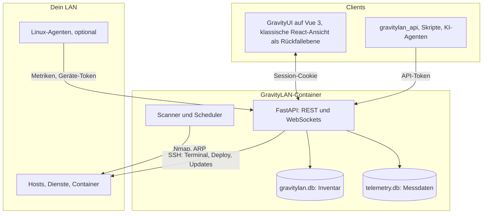

Architekturentscheidungen stehen in [docs/adr/](docs/adr).

### Entwicklung

**Windows:** `.\start_gravitylan.ps1` installiert die Abhängigkeiten und startet Uvicorn auf `:8000`, GravityUI auf `:5174` und die klassische Ansicht auf `:5173`.

**Linux und macOS:**

```bash
# Backend (Python 3.12+, Nmap installiert)
cd backend
pip install -r requirements.txt
python -m uvicorn app.main:app --reload --host 0.0.0.0 --port 8000

# GravityUI (Node 20+), in einem zweiten Terminal: http://localhost:5174/frontend-vue/, leitet /api an :8000 weiter
cd frontend-vue
npm install
npm run dev

# Klassische Ansicht, optional, auf :5173
cd frontend
npm install
npm run dev
```

GravityUI holt API-Client, Typen und Texte aus `frontend/src`; `frontend/` muss daneben liegen bleiben, auch wenn du nur an GravityUI arbeitest.

**Ohne dein Netz anzufassen:** `python scripts/dev_demo.py` (in der Backend-venv) startet die API auf `127.0.0.1:8000` mit einer Wegwerf-Demo-Datenbank, simulierten Agenten mit 24 Stunden Verlauf und einer Demo-Shell für SSH, aber ohne Scans. GravityUI wie oben starten, Passwort `demo`. `--reset` befüllt die Demo-Daten neu, `--fresh` startet wie eine Neuinstallation, `--company` lädt stattdessen ein kleines Firmennetz (8 VLANs, Proxmox-Cluster mit vier Knoten, rund 130 Geräte, vier Racks mit Ports und Kabeln, Backup-Verbindungen, eigene Datenbank). Die Screenshots in dieser README stammen daraus.

**Tests und Prüfungen:**

```bash
cd frontend-vue && npm test && npm run typecheck && npm run lint   # GravityUI (Vitest, vue-tsc, ESLint)
cd backend && python -m pytest                                    # Backend
python -m pytest gravitylan_api/tests                             # Python-Client, aus dem Repo-Root
cd frontend && npm test && npm run typecheck                      # klassische Ansicht
```

**Repo-Übersicht:**

```
agent/            Linux-Agent (gravitylan-agent.py) und systemd-Unit
backend/app/      FastAPI-App: api/, models/, schemas/, scanner/, services/, database/
backend/tests/    Backend-Tests (pytest)
frontend-vue/     GravityUI (Vue 3, Vite, Tailwind, Pinia); Designsystem in DESIGN.md
frontend/         Klassische React-Oberfläche (Rückfallebene); src/ enthält auch API-Client, Typen und Texte für GravityUI
gravitylan_api/   Python-Client
docs/             Sicherheits- und Design-Doku, ADRs, Screenshots (vue/, react/)
scripts/          Demo-Backend und Wartungsskripte
templates/        Unraid-Vorlage
```

Beiträge sind willkommen: siehe [CONTRIBUTING.md](CONTRIBUTING.md). Arbeit an der Oberfläche gehört nach `frontend-vue/`. Was sich pro Version geändert hat: [CHANGELOG.md](CHANGELOG.md).

### Lizenz

[MIT](LICENSE). Gebaut mit Antigravity und vielleicht ein bisschen zu viel Spaß am UI von **SleeperXr**.
