<div align="center">


# GravityLAN

**Your homelab, mapped and maintained.**<br>
Scan the network, keep an inventory of every device, draw the topology, watch and update your Linux hosts, and open a shell on any of them from the browser.

<sub>DE: Dein Homelab im Blick. Netz scannen, Geräte inventarisieren, Topologie zeichnen, Linux-Hosts überwachen und aktualisieren, Shell im Browser.</sub>

[](https://github.com/SleeperXr/GravityLAN/releases)
[](AGENT.md)
[](https://github.com/SleeperXr/GravityLAN/actions/workflows/ci.yml)
[](https://hub.docker.com/r/sleeperxr/gravitylan)
[](LICENSE)

[Quick start](#quick-start) · [Features](#features) · [Agent](#the-agent) · [Security](#security-and-operation) · [Changelog](CHANGELOG.md) · [Releases](https://github.com/SleeperXr/GravityLAN/releases) · [Docker Hub](https://hub.docker.com/r/sleeperxr/gravitylan) · [Deutsch](#deutsch)

</div>

<p align="center">
  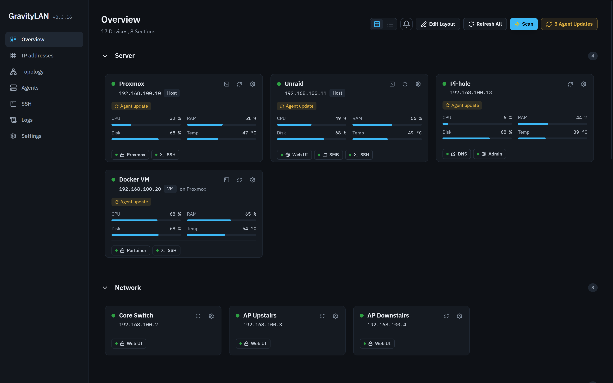
</p>

> [!NOTE]
> **Pre-release.** GravityLAN is in active development and features may change between versions. Export a backup (Settings → Backup & restore) before you upgrade.

<a id="english"></a>

## What it is

GravityLAN is a self-hosted dashboard for the network at home or in the lab. It sweeps your subnets, keeps every device it finds in one inventory, and lets you add what a scanner can't know: groups, racks, cabling, which VM runs on which host. Install the optional agent on your Linux machines and the same inventory shows their load, disks and temperatures, counts pending package updates and installs them on request.

Everything runs in **one container** with **one SQLite file**: a FastAPI backend and a React interface, in English and German, usable on a phone. It is built for a **trusted home network**, not for direct exposure to the internet.

## Features

| Area | What you get |
|---|---|
| **Discovery** | Scheduled Nmap and ARP scans of your subnets, plus a lighter presence check in between: hosts, open ports, services, hostnames (DNS, mDNS) and vendors. Containers with their own LAN address are found too, also `ipvlan` setups where several of them share the host's MAC. A device only counts as offline after several failed checks in a row (ping, ARP and TCP; 3 by default), so busy hosts don't flap. |
| **Overview** | Your devices in your own sections, as tiles or a list, with live agent metrics and service links that open the web UI (or copy the SMB path). IP changes, issues and a notification feed; tiles can be arranged freely. |
| **IP addresses** | A map of each subnet's address space: used, free, online, offline. Manage subnets, named areas and per-subnet scan settings. |
| **Topology & racks** | Draw how devices are connected, with link speeds (1, 2.5, 10 GbE …) and an animated data flow, or switch to the rack view and place devices by height unit. |
| **Linux agent** | One Python script per host, reporting CPU, RAM, disks, network and temperature (every 30 s by default) with a 6 h to 30 day history. Detects the OS and knows LXC containers and ZFS pools. |
| **Package updates** | The agent counts pending updates (apt, dnf, yum), and you install them over SSH from the Agents page with live output, also as a sudo user. |
| **SSH terminal** | Shells on your devices in the browser, also on phones: tabs that stay open while you use the rest of GravityLAN, saved and recent connections, host key check, copy, paste and "copy last command", fonts and colour schemes. Keys (OpenSSH, PEM, PuTTY `.ppk`) are stored encrypted on the server. |
| **Agent rollout** | Install or update agents over SSH (with a saved key connection or credentials you type in), with a one-line installer carrying a one-time code, for all outdated agents at once in the Agent Update Center, or straight from an open terminal. |
| **API & integrations** | REST API with Swagger UI at `/docs`, a Python client ([`gravitylan_api`](gravitylan_api)), read-only API tokens (finer scopes through the API) and webhooks for `device.offline` and `scan.complete`. |
| **Backup & restore** | Export and import devices, groups and settings as JSON. An import never touches the admin password, the master token or the setup state. |
| **Setup & settings** | A setup wizard on first start; scan schedule, offline threshold, DNS server, history retention, log level, language, password, API tokens and a live log viewer. |

## Screenshots

<table>
  <tr>
    <td width="50%" valign="top">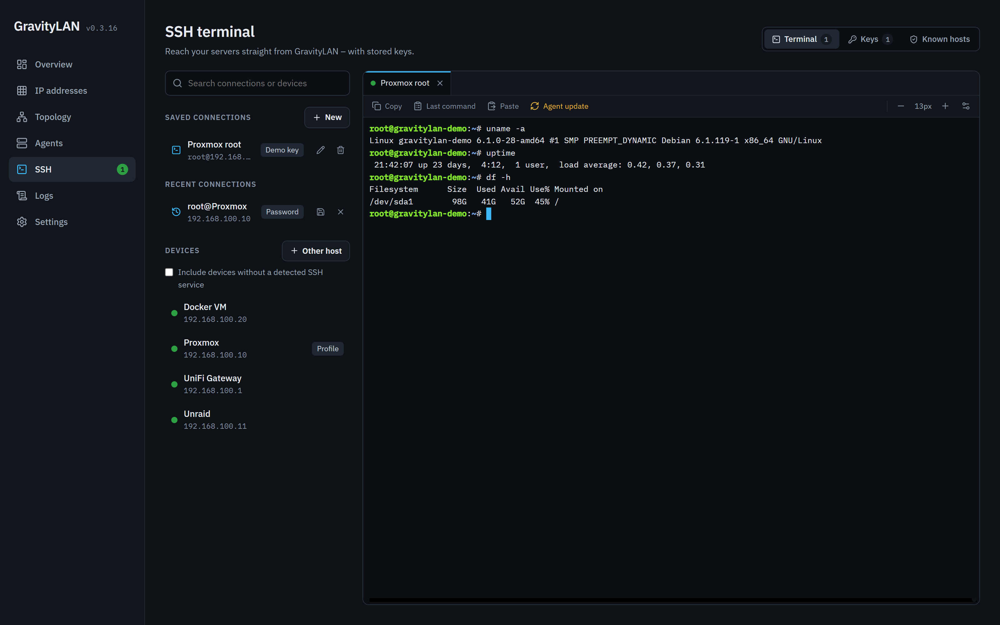<br><sub><b>SSH terminal</b>: tabs, saved connections, agent update</sub></td>
    <td width="50%" valign="top">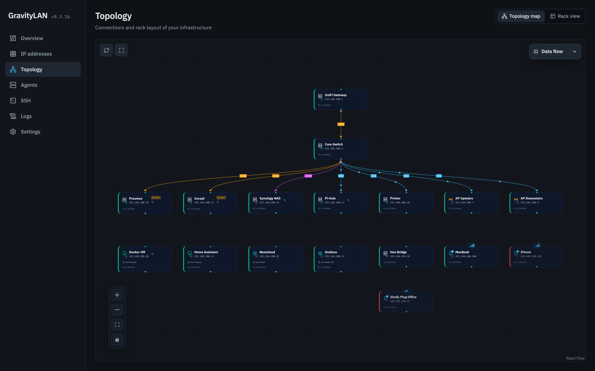<br><sub><b>Topology</b>: devices, links and link speeds</sub></td>
  </tr>
  <tr>
    <td width="50%" valign="top">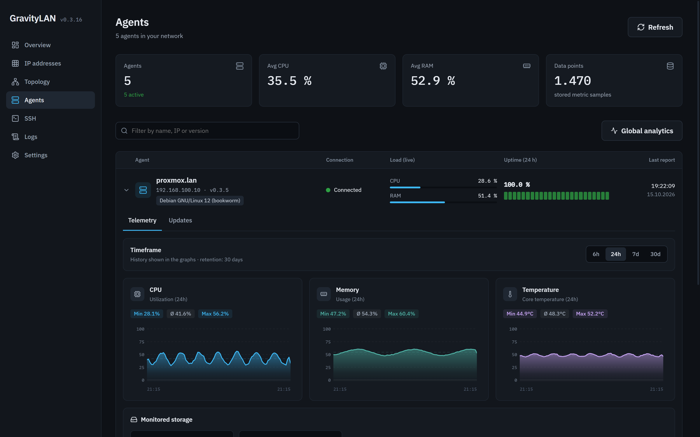<br><sub><b>Agents</b>: live load, availability, history</sub></td>
    <td width="50%" valign="top">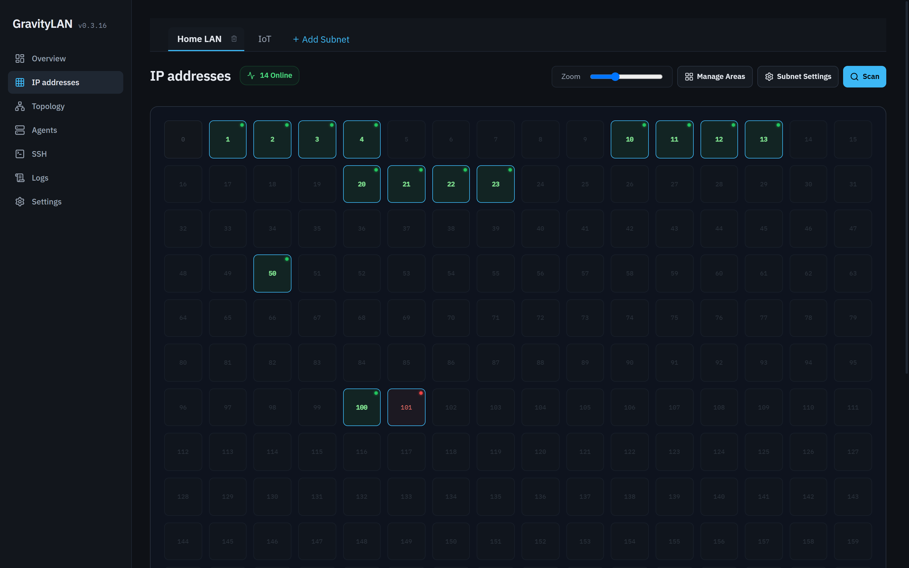<br><sub><b>IP addresses</b>: every address of a subnet</sub></td>
  </tr>
  <tr>
    <td width="50%" valign="top">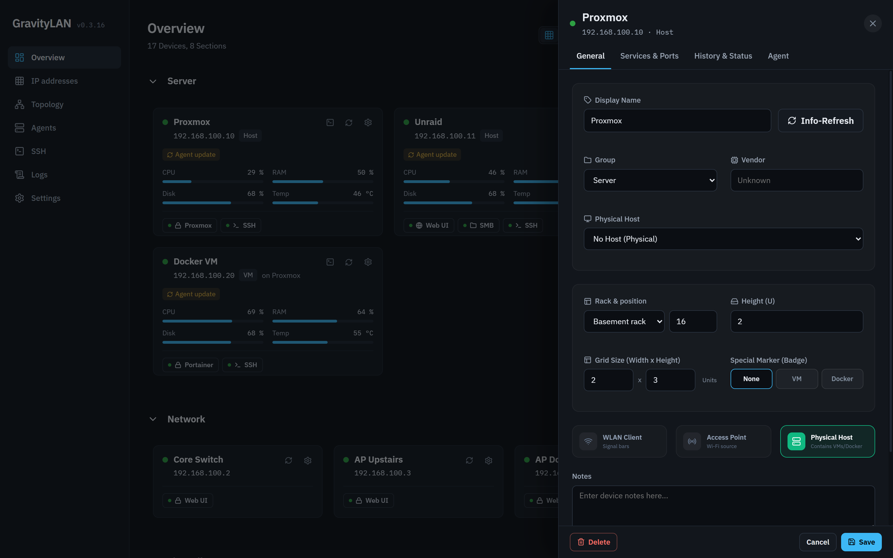<br><sub><b>Device editor</b>: group, host, rack position</sub></td>
    <td width="50%" valign="top">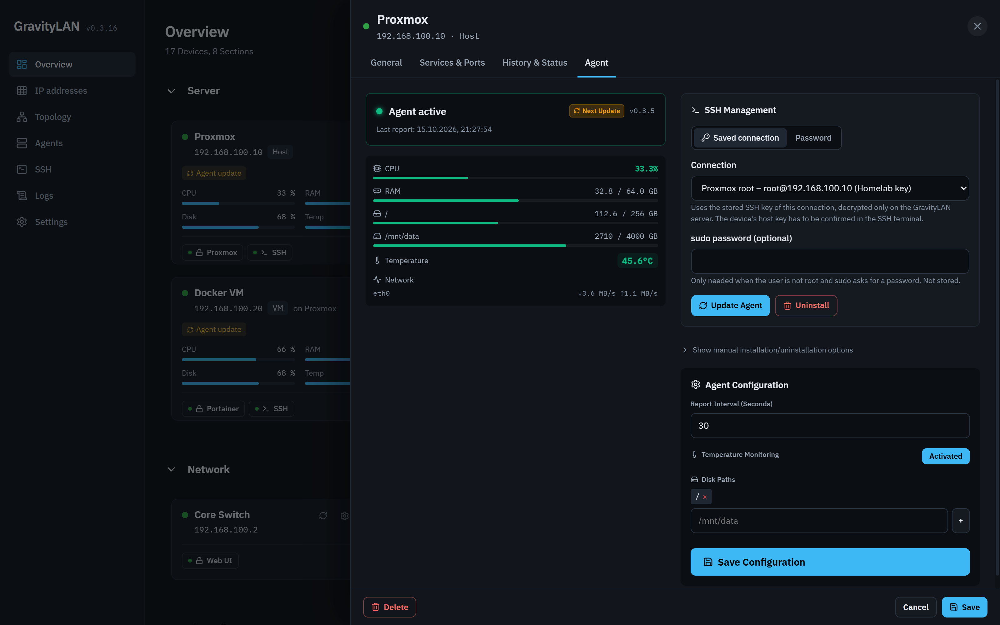<br><sub><b>Agent tab</b>: update over a saved key connection</sub></td>
  </tr>
</table>

<p align="center">
  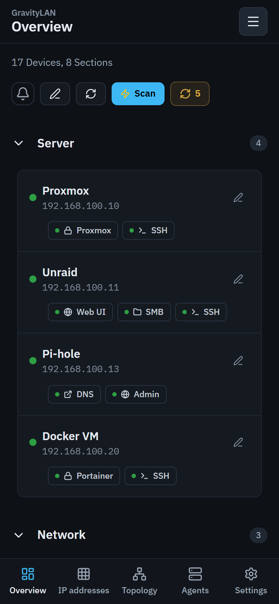
  &nbsp;&nbsp;
  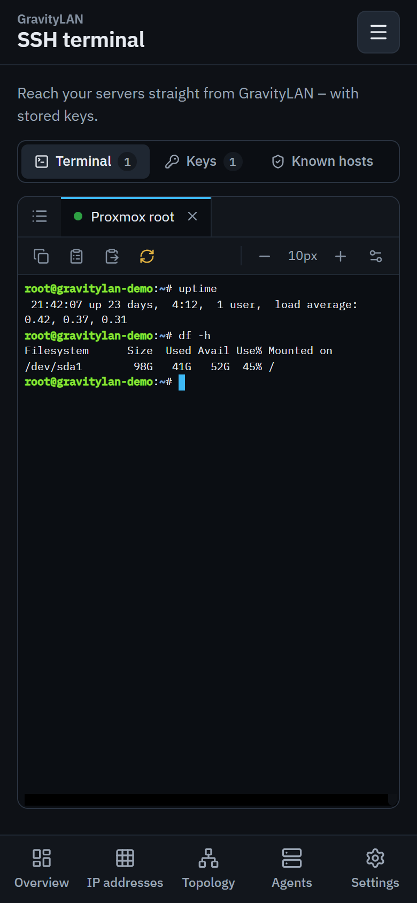
</p>

## Quick start

```bash
docker run -d --name gravitylan \
  -p 8000:8000 \
  -v gravitylan-data:/app/data \
  --cap-add=NET_RAW --cap-add=NET_ADMIN \
  --restart unless-stopped \
  sleeperxr/gravitylan:latest
```

Open `http://<your-host>:8000` and go through the setup wizard: it detects your subnets, runs the first scan and sets the admin password.

> [!IMPORTANT]
> **Finish the setup wizard right after the first start.** Until then only the wizard's own routes answer, but whoever opens the page first chooses the admin password. The same applies after a factory reset.

**Docker Compose.** The repository has four variants; start one with `docker compose -f <file> up -d`:

- [`docker-compose.yml`](docker-compose.yml): bridge network on port 8000. The simplest start; ARP and MAC detection only see what the bridge passes through.
- [`docker-compose.hostnet.yml`](docker-compose.hostnet.yml): host network. The best view of the LAN (ARP, MAC addresses, multicast), with less isolation.
- [`docker-compose.macvlan.yml`](docker-compose.macvlan.yml): macvlan, so the container gets its own address in your LAN. Set `GRAVITYLAN_IP`, `GRAVITYLAN_SUBNET`, `GRAVITYLAN_GATEWAY` and `GRAVITYLAN_INTERFACE` for your network.
- [`docker-compose.unraid.yml`](docker-compose.unraid.yml): host network for Unraid; builds the image from a checkout of this repository.

The image is multi-stage (Vite build, then a slim Python runtime) and runs as a non-root user; Nmap gets only the capabilities it needs. To build it yourself: `docker build -t gravitylan:local .`

## The agent

The agent is optional: discovery, topology and the SSH terminal work without it. It is a single Python script that runs as a service on a Linux host and reports to GravityLAN with its own device token. It uses systemd where available, Synology's rc.d, a copy on the flash drive on Unraid (which runs from RAM), or a plain background start.

**Install** from the **Agent** tab of the device editor:

1. **Over SSH**: pick a saved key connection of the device or type in a user and password. Typed-in credentials are used for that request only and never stored. A saved key is decrypted on the GravityLAN server only, and only used for a host whose key you have confirmed in the SSH terminal.
2. **One-line installer**: copy the `curl … | sudo bash` command and run it on the host. It carries a one-time code (valid 30 minutes, usable once); "New code" makes a fresh one.

**Update.** When the server ships a newer agent, the overview shows how many hosts are behind. The **Agent Update Center** updates them together (each with its saved key connection, the rest with one user and password), an open SSH terminal offers an **Agent update** button that types the command into the shell for you to check and run, and the one-line installer works for updates too.

To uninstall, use the same tab (over SSH) or the uninstall one-liner next to the installer. More detail: [AGENT.md](AGENT.md).

## Python client

```bash
pip install ./gravitylan_api
```

```python
from gravitylan_api import GravityLANClient

client = GravityLANClient(base_url="http://gravitylan.local:8000", token="<API token>")
for device in client.devices.list():
    print(device["display_name"], device["ip"])
```

Create a token under **Settings → API Tokens (Read-Only)**. The client also reads `GRAVITYLAN_BASE_URL` and `GRAVITYLAN_TOKEN` from the environment and only needs `requests`.

## Configuration

Most options live in the database and are changed in the setup wizard and on the Settings page. Environment variables (prefix `GRAVITYLAN_`, see [`backend/app/config.py`](backend/app/config.py)):

| Variable | Meaning | Default |
|---|---|---|
| `GRAVITYLAN_DATA_DIR` | Data directory (SQLite database, vault key) | `/app/data` |
| `GRAVITYLAN_DATABASE_URL` | Full SQLAlchemy URL, if you don't want SQLite in the data directory | empty |
| `GRAVITYLAN_PORT` / `GRAVITYLAN_HOST` | Listen port and address | `8000` / `0.0.0.0` |
| `GRAVITYLAN_DEBUG` | Verbose logging | `false` |
| `GRAVITYLAN_SECURE_COOKIES` | Mark the session cookie `Secure`; turn on behind HTTPS | `false` |
| `GRAVITYLAN_SSH_STRICT_MODE` | Refuse unknown SSH host keys when deploying agents or installing updates | `false` |
| `GRAVITYLAN_SSH_IDLE_TIMEOUT_MINUTES` | Close terminal sessions without input after N minutes (0 = never) | `30` |
| `GRAVITYLAN_SSH_MAX_SESSIONS` | Maximum number of open terminal sessions | `10` |
| `GRAVITYLAN_VAULT_KEY` | Key for the encrypted SSH key store; otherwise generated as `data/ssh_vault.key` | empty |
| `GRAVITYLAN_HISTORY_RETENTION_DAYS` | Keep metrics and history for N days (1 to 365) | `30` |
| `GRAVITYLAN_SCAN_TIMEOUT` | Port connect timeout per target, in seconds | `1.5` |
| `GRAVITYLAN_SCAN_WORKERS` | Scanner concurrency | `20` |
| `GRAVITYLAN_SCAN_INTERVAL_MINUTES` | Automatic scan interval (0 = off) | `0` |
| `GRAVITYLAN_CORS_ORIGINS` | Extra CORS origins (not needed for the bundled UI) | empty |

## Security and operation

GravityLAN assumes a **trusted home network**. For access from outside, use a VPN or your usual reverse proxy with HTTPS, and set `GRAVITYLAN_SECURE_COOKIES=true`. Over plain HTTP, terminal keystrokes cross the network unencrypted.

- **Login**: `httpOnly` session cookie, Argon2 password hashes. After 5 failed attempts within a minute from one address, logins are refused for the rest of that minute. Behind a reverse proxy on another machine, all attempts count against the proxy's address.
- **API tokens** are stored hashed and are read-only unless given other scopes. Each agent has its own token, and an unknown agent has to be adopted on its device card.
- **SSH**: keys and stored passwords are encrypted on the server and never sent back to the browser. Only logged-in browser sessions can open shells or use saved keys, not API or master tokens. A host whose key changed is blocked until you remove the old entry. Details: [ADR 002](docs/adr/002-ssh-keystore.md).
- **Agent install**: the agent's config is readable by root only, its service runs with a private `/tmp` and read-only home directories, and install codes are masked in the request log. The server URL written into the installer has to be a plain `http(s)://host[:port][/path]`.
- **Webhooks** can't target the GravityLAN host itself, link-local addresses or cloud metadata services; the target is checked again before every delivery. LAN addresses work.
- **Backups** don't contain SSH keys, stored passwords or agent tokens, and importing one never replaces the admin password, the master token or the setup state. Keep `data/ssh_vault.key` (or `GRAVITYLAN_VAULT_KEY`) safe on its own: without it, stored keys can't be decrypted.

More: [SECURITY.md](SECURITY.md) · [Threat model](docs/threat-model.md) · [Container hardening](docs/container-hardening.md) · [Security baseline](docs/security-baseline.md)

## Architecture

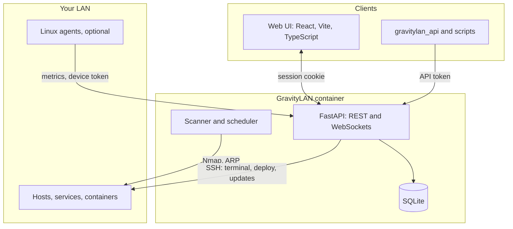

Architecture decisions are recorded in [docs/adr/](docs/adr).

## Development

**Windows:** `.\start_gravitylan.ps1` installs the dependencies and starts Uvicorn on `:8000` and Vite on `:5173`.

**Linux and macOS:**

```bash
# Backend (Python 3.12+, Nmap installed)
cd backend
pip install -r requirements.txt
python -m uvicorn app.main:app --reload --host 0.0.0.0 --port 8000

# Frontend (Node 20+), in a second terminal; proxies /api to :8000
cd frontend
npm install
npm run dev
```

**Without touching your network:** `python scripts/dev_demo.py` (in the backend virtualenv) starts the API on `127.0.0.1:8000` with a throw-away demo database, simulated agents and a fake SSH shell, but no scans. Start the frontend as above and log in with `demo`. `--reset` seeds the demo data again, `--fresh` starts like a new install.

**Tests and checks:**

```bash
cd backend && python -m pytest          # backend
python -m pytest gravitylan_api/tests   # Python client, from the repository root
cd frontend && npm test                 # frontend (Vitest)
cd frontend && npm run typecheck        # TypeScript
```

**Repository layout:**

```
agent/            Linux agent (gravitylan-agent.py) and systemd unit
backend/app/      FastAPI app: api/, models/, schemas/, scanner/, services/, database/
backend/tests/    Backend tests (pytest)
frontend/         React UI (Vite, TypeScript, Tailwind)
gravitylan_api/   Python client
docs/             Security and design docs, ADRs, screenshots
scripts/          Demo backend and maintenance scripts
```

Contributions are welcome: see [CONTRIBUTING.md](CONTRIBUTING.md). What changed in each version: [CHANGELOG.md](CHANGELOG.md).

## License

[MIT](LICENSE). Built with Antigravity and maybe a little too much fun with the UI by **SleeperXr**.

---

## Deutsch

### Worum es geht

GravityLAN ist ein selbst gehostetes Dashboard fürs Heim- oder Labornetz. Es durchsucht deine Subnetze, führt jedes gefundene Gerät in einem Inventar und lässt dich ergänzen, was ein Scanner nicht wissen kann: Gruppen, Racks, Verkabelung, welche VM auf welchem Host läuft. Mit dem optionalen Agenten auf deinen Linux-Rechnern zeigt dasselbe Inventar deren Auslastung, Laufwerke und Temperaturen, zählt offene Paket-Updates und spielt sie auf Wunsch ein.

Alles läuft in **einem Container** mit **einer SQLite-Datei**: ein FastAPI-Backend und eine React-Oberfläche, auf Deutsch und Englisch, auch am Handy bedienbar. GravityLAN ist für ein **vertrauenswürdiges Heimnetz** gebaut, nicht für den direkten Betrieb im Internet.

### Funktionen

| Bereich | Was du bekommst |
|---|---|
| **Erkennung** | Geplante Nmap- und ARP-Scans deiner Subnetze, dazwischen ein leichterer Anwesenheits-Check: Hosts, offene Ports, Dienste, Hostnamen (DNS, mDNS) und Hersteller. Auch Container mit eigener LAN-Adresse werden gefunden, ebenso `ipvlan`-Setups, in denen sich mehrere die MAC des Hosts teilen. Offline gilt ein Gerät erst nach mehreren Fehlversuchen in Folge (Ping, ARP und TCP; standardmäßig 3), damit ausgelastete Hosts nicht flackern. |
| **Übersicht** | Deine Geräte in eigenen Bereichen, als Kacheln oder Liste, mit Live-Werten vom Agenten und Dienst-Links, die die Weboberfläche öffnen (oder den SMB-Pfad kopieren). IP-Wechsel, Probleme und ein Benachrichtigungs-Feed; die Kacheln lassen sich frei anordnen. |
| **IP-Adressen** | Eine Karte des Adressraums jedes Subnetzes: belegt, frei, online, offline. Subnetze, benannte Bereiche und Scan-Einstellungen pro Subnetz verwalten. |
| **Topologie & Racks** | Zeichne, wie Geräte verbunden sind, mit Link-Geschwindigkeiten (1, 2,5, 10 GbE …) und animiertem Datenfluss, oder wechsle in die Rack-Ansicht und setze Geräte auf Höheneinheiten. |
| **Linux-Agent** | Ein Python-Skript pro Host, das CPU, RAM, Laufwerke, Netzwerk und Temperatur meldet (standardmäßig alle 30 s), mit Verlauf von 6 Stunden bis 30 Tagen. Erkennt das Betriebssystem und kennt LXC-Container und ZFS-Pools. |
| **Paket-Updates** | Der Agent zählt offene Updates (apt, dnf, yum), eingespielt werden sie per SSH aus der Agents-Seite mit Live-Ausgabe, auch mit einem sudo-Benutzer. |
| **SSH-Terminal** | Shells auf deine Geräte im Browser, auch am Handy: Tabs, die offen bleiben, während du den Rest von GravityLAN nutzt, gespeicherte und zuletzt genutzte Verbindungen, Host-Key-Prüfung, Kopieren, Einfügen und „Letzten Befehl kopieren“, Schriften und Farbschemata. Keys (OpenSSH, PEM, PuTTY `.ppk`) liegen verschlüsselt auf dem Server. |
| **Agent-Verteilung** | Agenten per SSH installieren oder aktualisieren (mit gespeicherter Key-Verbindung oder eingegebenen Zugangsdaten), per Einzeiler mit Einmal-Code, alle veralteten auf einmal im Agent-Update-Center oder direkt aus einem offenen Terminal. |
| **API & Integrationen** | REST-API mit Swagger UI unter `/docs`, ein Python-Client ([`gravitylan_api`](gravitylan_api)), schreibgeschützte API-Token (feinere Scopes über die API) und Webhooks für `device.offline` und `scan.complete`. |
| **Backup & Wiederherstellung** | Geräte, Gruppen und Einstellungen als JSON exportieren und importieren. Ein Import ändert nie Admin-Passwort, Master-Token oder Setup-Status. |
| **Einrichtung & Einstellungen** | Setup-Wizard beim ersten Start; Scan-Zeitplan, Offline-Schwelle, DNS-Server, Aufbewahrung der Historie, Log-Level, Sprache, Passwort, API-Token und eine Live-Log-Ansicht. |

### Screenshots

<table>
  <tr>
    <td width="50%" valign="top"><br><sub><b>SSH-Terminal</b>: Tabs, Verbindungen, Agent-Update</sub></td>
    <td width="50%" valign="top"><br><sub><b>Topologie</b>: Geräte, Verbindungen, Geschwindigkeiten</sub></td>
  </tr>
  <tr>
    <td width="50%" valign="top"><br><sub><b>Agents</b>: Live-Last, Verfügbarkeit, Verlauf</sub></td>
    <td width="50%" valign="top"><br><sub><b>IP-Adressen</b>: jede Adresse eines Subnetzes</sub></td>
  </tr>
  <tr>
    <td width="50%" valign="top"><br><sub><b>Geräte-Editor</b>: Gruppe, Host, Rack-Position</sub></td>
    <td width="50%" valign="top"><br><sub><b>Agent-Tab</b>: Update über gespeicherte Key-Verbindung</sub></td>
  </tr>
</table>

### Schnellstart

```bash
docker run -d --name gravitylan \
  -p 8000:8000 \
  -v gravitylan-data:/app/data \
  --cap-add=NET_RAW --cap-add=NET_ADMIN \
  --restart unless-stopped \
  sleeperxr/gravitylan:latest
```

`http://<dein-host>:8000` öffnen und den Setup-Wizard durchgehen: Er erkennt deine Subnetze, startet den ersten Scan und legt das Admin-Passwort fest.

> [!IMPORTANT]
> **Schließ den Setup-Wizard direkt nach dem ersten Start ab.** Bis dahin antworten nur die Routen des Wizards, aber wer die Seite zuerst öffnet, wählt das Admin-Passwort. Das gilt genauso nach einem Werksreset.

**Docker Compose.** Im Repository liegen vier Varianten; starten mit `docker compose -f <datei> up -d`:

- [`docker-compose.yml`](docker-compose.yml): Bridge-Netzwerk auf Port 8000. Der einfachste Start; ARP- und MAC-Erkennung sehen nur, was die Bridge durchreicht.
- [`docker-compose.hostnet.yml`](docker-compose.hostnet.yml): Host-Netzwerk. Die beste Sicht aufs LAN (ARP, MAC-Adressen, Multicast), dafür weniger Isolation.
- [`docker-compose.macvlan.yml`](docker-compose.macvlan.yml): Macvlan, der Container bekommt eine eigene Adresse im LAN. `GRAVITYLAN_IP`, `GRAVITYLAN_SUBNET`, `GRAVITYLAN_GATEWAY` und `GRAVITYLAN_INTERFACE` an dein Netz anpassen.
- [`docker-compose.unraid.yml`](docker-compose.unraid.yml): Host-Netzwerk für Unraid; baut das Image aus einem Checkout dieses Repositorys.

Das Image ist mehrstufig gebaut (Vite-Build, dann eine schlanke Python-Laufzeit) und läuft als Nicht-root-Benutzer; Nmap bekommt nur die Capabilities, die es braucht. Selbst bauen: `docker build -t gravitylan:local .`

### Der Agent

Der Agent ist optional: Erkennung, Topologie und SSH-Terminal funktionieren ohne ihn. Er ist ein einzelnes Python-Skript, das als Dienst auf einem Linux-Host läuft und sich mit einem eigenen Geräte-Token bei GravityLAN meldet. Er nutzt systemd, wo vorhanden, Synologys rc.d, auf Unraid (läuft aus dem RAM) eine Kopie auf dem USB-Stick oder einen einfachen Hintergrundstart.

**Installieren** im **Agent**-Tab des Geräte-Editors:

1. **Per SSH**: eine gespeicherte Key-Verbindung des Geräts wählen oder Benutzer und Passwort eingeben. Eingegebene Zugangsdaten gelten nur für diese Anfrage und werden nie gespeichert. Ein gespeicherter Key wird nur auf dem GravityLAN-Server entschlüsselt und nur für einen Host verwendet, dessen Host-Key du im SSH-Terminal bestätigt hast.
2. **Einzeiler**: den Befehl `curl … | sudo bash` kopieren und auf dem Host ausführen. Er enthält einen Einmal-Code (30 Minuten gültig, nur einmal nutzbar); „Neuer Code“ erzeugt einen frischen.

**Aktualisieren.** Bringt der Server einen neueren Agenten mit, zeigt die Übersicht, wie viele Hosts zurückliegen. Das **Agent-Update-Center** aktualisiert sie gemeinsam (jeden mit seiner gespeicherten Key-Verbindung, die übrigen mit einem Benutzer und Passwort), ein offenes SSH-Terminal bietet die Schaltfläche **Agent-Update**, die den Befehl zum Prüfen und Ausführen in die Shell schreibt, und auch der Einzeiler funktioniert für Updates.

Deinstallieren geht im selben Tab (per SSH) oder mit dem Deinstallations-Einzeiler neben dem Installer. Mehr dazu: [AGENT.md](AGENT.md).

### Python-Client

```bash
pip install ./gravitylan_api
```

```python
from gravitylan_api import GravityLANClient

client = GravityLANClient(base_url="http://gravitylan.local:8000", token="<API-Token>")
for device in client.devices.list():
    print(device["display_name"], device["ip"])
```

Ein Token erstellst du unter **Einstellungen → API-Token (Read-Only)**. Der Client liest außerdem `GRAVITYLAN_BASE_URL` und `GRAVITYLAN_TOKEN` aus der Umgebung und braucht nur `requests`.

### Konfiguration

Die meisten Optionen liegen in der Datenbank und werden im Setup-Wizard und in den Einstellungen geändert. Umgebungsvariablen (Präfix `GRAVITYLAN_`, siehe [`backend/app/config.py`](backend/app/config.py)):

| Variable | Bedeutung | Standard |
|---|---|---|
| `GRAVITYLAN_DATA_DIR` | Datenordner (SQLite-Datenbank, Vault-Schlüssel) | `/app/data` |
| `GRAVITYLAN_DATABASE_URL` | Vollständige SQLAlchemy-URL, falls nicht SQLite im Datenordner | leer |
| `GRAVITYLAN_PORT` / `GRAVITYLAN_HOST` | Port und Adresse | `8000` / `0.0.0.0` |
| `GRAVITYLAN_DEBUG` | Ausführliche Logs | `false` |
| `GRAVITYLAN_SECURE_COOKIES` | Session-Cookie als `Secure` markieren; hinter HTTPS einschalten | `false` |
| `GRAVITYLAN_SSH_STRICT_MODE` | Unbekannte SSH-Host-Keys beim Agent-Deploy und bei Updates ablehnen | `false` |
| `GRAVITYLAN_SSH_IDLE_TIMEOUT_MINUTES` | Terminal-Sitzungen ohne Eingabe nach N Minuten schließen (0 = nie) | `30` |
| `GRAVITYLAN_SSH_MAX_SESSIONS` | Maximal gleichzeitig offene Terminal-Sitzungen | `10` |
| `GRAVITYLAN_VAULT_KEY` | Schlüssel für den verschlüsselten SSH-Key-Store; sonst erzeugt als `data/ssh_vault.key` | leer |
| `GRAVITYLAN_HISTORY_RETENTION_DAYS` | Metriken und Historie N Tage aufbewahren (1 bis 365) | `30` |
| `GRAVITYLAN_SCAN_TIMEOUT` | Port-Timeout pro Ziel in Sekunden | `1.5` |
| `GRAVITYLAN_SCAN_WORKERS` | Parallelität des Scanners | `20` |
| `GRAVITYLAN_SCAN_INTERVAL_MINUTES` | Intervall für automatische Scans (0 = aus) | `0` |
| `GRAVITYLAN_CORS_ORIGINS` | Zusätzliche CORS-Origins (für die mitgelieferte Oberfläche nicht nötig) | leer |

### Sicherheit und Betrieb

GravityLAN geht von einem **vertrauenswürdigen Heimnetz** aus. Für Zugriff von außen nutze ein VPN oder deinen gewohnten Reverse-Proxy mit HTTPS und setze `GRAVITYLAN_SECURE_COOKIES=true`. Über reines HTTP gehen Terminal-Eingaben unverschlüsselt durchs Netz.

- **Login**: `httpOnly`-Session-Cookie, Passwörter mit Argon2 gehasht. Nach 5 Fehlversuchen innerhalb einer Minute von einer Adresse werden Anmeldungen für den Rest dieser Minute abgelehnt. Hinter einem Reverse-Proxy auf einem anderen Rechner zählen alle Versuche gegen die Adresse des Proxys.
- **API-Token** werden gehasht gespeichert und sind schreibgeschützt, solange sie keine anderen Scopes bekommen. Jeder Agent hat sein eigenes Token, und ein unbekannter Agent muss auf seiner Gerätekarte übernommen werden.
- **SSH**: Keys und gespeicherte Passwörter liegen verschlüsselt auf dem Server und gehen nie zurück an den Browser. Nur angemeldete Browser-Sitzungen können Shells öffnen oder gespeicherte Keys verwenden, keine API- oder Master-Token. Ein Host mit geändertem Host-Key wird blockiert, bis du den alten Eintrag entfernst. Details: [ADR 002](docs/adr/002-ssh-keystore.md).
- **Agent-Installation**: Die Konfiguration des Agenten ist nur für root lesbar, sein Dienst läuft mit eigenem `/tmp` und schreibgeschützten Home-Verzeichnissen, und Installations-Codes werden im Request-Log maskiert. Die Server-URL im Installer muss eine einfache `http(s)://host[:port][/pfad]` sein.
- **Webhooks** können weder den GravityLAN-Host selbst noch Link-Local-Adressen oder Cloud-Metadatendienste ansprechen; das Ziel wird vor jeder Zustellung erneut geprüft. LAN-Adressen funktionieren.
- **Backups** enthalten keine SSH-Keys, gespeicherten Passwörter oder Agent-Token, und ein Import ersetzt nie Admin-Passwort, Master-Token oder Setup-Status. Bewahre `data/ssh_vault.key` (oder `GRAVITYLAN_VAULT_KEY`) separat sicher auf: Ohne ihn lassen sich gespeicherte Keys nicht entschlüsseln.

Mehr: [SECURITY.md](SECURITY.md) · [Bedrohungsmodell](docs/threat-model.md) · [Container-Härtung](docs/container-hardening.md) · [Sicherheits-Baseline](docs/security-baseline.md)

### Architektur

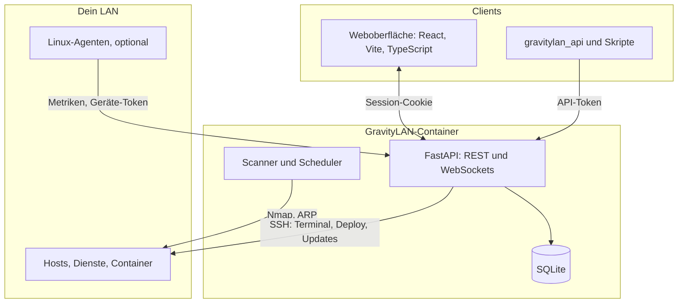

Architekturentscheidungen stehen in [docs/adr/](docs/adr).

### Entwicklung

**Windows:** `.\start_gravitylan.ps1` installiert die Abhängigkeiten und startet Uvicorn auf `:8000` und Vite auf `:5173`.

**Linux und macOS:**

```bash
# Backend (Python 3.12+, Nmap installiert)
cd backend
pip install -r requirements.txt
python -m uvicorn app.main:app --reload --host 0.0.0.0 --port 8000

# Frontend (Node 20+), in einem zweiten Terminal; leitet /api an :8000 weiter
cd frontend
npm install
npm run dev
```

**Ohne dein Netz anzufassen:** `python scripts/dev_demo.py` (in der Backend-venv) startet die API auf `127.0.0.1:8000` mit einer Wegwerf-Demo-Datenbank, simulierten Agenten und einer Demo-Shell für SSH, aber ohne Scans. Frontend wie oben starten, Passwort `demo`. `--reset` befüllt die Demo-Daten neu, `--fresh` startet wie eine Neuinstallation.

**Tests und Prüfungen:**

```bash
cd backend && python -m pytest          # Backend
python -m pytest gravitylan_api/tests   # Python-Client, aus dem Repo-Root
cd frontend && npm test                 # Frontend (Vitest)
cd frontend && npm run typecheck        # TypeScript
```

**Repo-Übersicht:**

```
agent/            Linux-Agent (gravitylan-agent.py) und systemd-Unit
backend/app/      FastAPI-App: api/, models/, schemas/, scanner/, services/, database/
backend/tests/    Backend-Tests (pytest)
frontend/         React-Oberfläche (Vite, TypeScript, Tailwind)
gravitylan_api/   Python-Client
docs/             Sicherheits- und Design-Doku, ADRs, Screenshots
scripts/          Demo-Backend und Wartungsskripte
```

Beiträge sind willkommen: siehe [CONTRIBUTING.md](CONTRIBUTING.md). Was sich pro Version geändert hat: [CHANGELOG.md](CHANGELOG.md).

### Lizenz

[MIT](LICENSE). Gebaut mit Antigravity und vielleicht ein bisschen zu viel Spaß am UI von **SleeperXr**.
