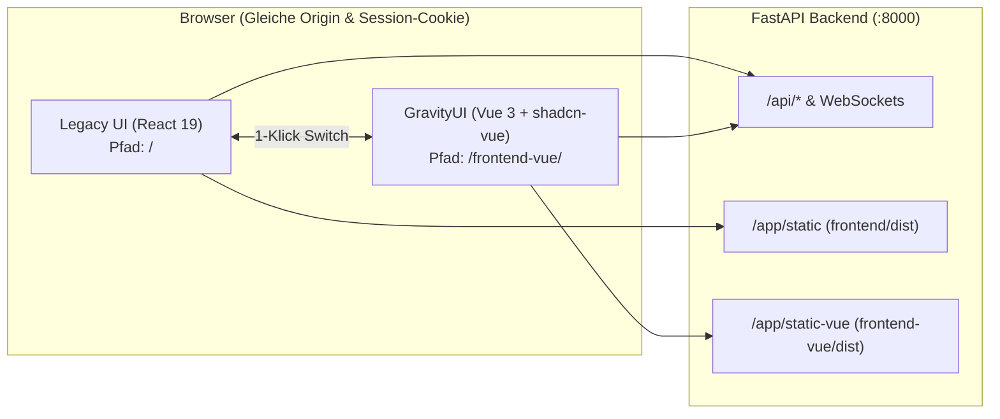

# PLAN: GravityUI (`frontend-vue`) — Dual-UI Architektur mit `shadcn-vue` Standard-Dashboards

> **Status:** 🚀 In Umsetzung (Phase 1 & 2 freigegeben)  
> **Update 2026-10-27:** Die Dual-UI ist eine Übergangsphase. Laut [ADR-003](adr/003-react-retirement.md) wird GravityUI nach Feature-Parität Standard, React bleibt eine Version als Fallback und wird danach entfernt.  
> **Project Type:** `WEB` (Primary Agent: `@[frontend-specialist]`, Support: `@[backend-specialist]`, `@[devops-engineer]`, `@[test-engineer]`)  
> **Architektur-Prinzip:** **Legacy UI (`/` in React) bleibt zu 100 % intakt** + **GravityUI (`/frontend-vue` in Vue 3 + `shadcn-vue`)** mit **1-Klick-Umschalter** in beiden Oberflächen (sofort `main`-ready).

---

## 1. Overview (Was & Warum)

Statt einer riskanten Big-Bang-Ablösung des bestehenden React-Frontends wird **GravityUI** (`frontend-vue/`) als parallele, moderne Oberfläche auf Basis von **Vue 3.5+ (`<script setup lang="ts">`) + `shadcn-vue` (`reka-ui`) + Tailwind CSS v4** mit **strukturierten Standard-Dashboards** aufgebaut:

1. **Zero-Risk für `main`:** Das bestehende React-Frontend (`frontend/`) läuft unverändert unter `/` weiter. Alle bestehenden Workflows, Tests und Bookmarks bleiben intakt.
2. **1-Klick-Wechsel (`Legacy UI` ↔ `GravityUI`):**
   - In der Legacy-Sidebar ([`frontend/src/components/Sidebar.tsx`](file:///e:/Users/Oliver/Etc/Projekte/Antigravity/GravityLAN/frontend/src/components/Sidebar.tsx)) führt ein Button direkt zu `/frontend-vue/`.
   - In der GravityUI-Sidebar (`frontend-vue/src/components/layout/AppSidebar.vue`) führt ein Button mit einem Klick zurück zu `/` (Legacy UI).
   - Da beide Frontends unter derselben Origin laufen, teilen sie sich automatisch das **`httpOnly`-Session-Cookie** und alle `/api/*`- sowie WebSocket-Endpunkte (kein doppelter Login nötig).
3. **Standard-Dashboards statt Custom-Gridstack:** GravityUI nutzt das `shadcn-vue` Dashboard-Paradigma (App-Shell mit fester Sidebar, Top-Header, strukturierte KPI-Cards, sortier-/filterbare Data-Tables, Status-Badges und Slide-Over `Sheet`-Drawers).

---

## 2. Dual-UI Routing- & Bereitstellungs-Architektur



| Umgebung | Legacy UI (`/`) | GravityUI (`/frontend-vue/`) | API & Auth (`/api/*`) |
| :--- | :--- | :--- | :--- |
| **Development** | Vite (`:5173`) mit Proxy für `/frontend-vue` → `:5174` | Vite (`:5174`, `base: '/frontend-vue/'`) | Proxy auf FastAPI (`127.0.0.1:8000`) |
| **Production / Docker** | FastAPI `FRONTEND_DIR` (`/app/static`) | FastAPI `FRONTEND_VUE_DIR` (`/app/static-vue`) | Gleiche FastAPI-Instanz (`:8000`) |

---

## 3. Tech Stack (`frontend-vue/`)

| Bereich | Technologie | Begründung |
| :--- | :--- | :--- |
| **Framework** | `vue` 3.5+, `vue-router` 4.5+, `pinia` | Reaktive Composition API, schlanker State, Base-Routing auf `/frontend-vue/` |
| **UI-System** | `shadcn-vue` (`reka-ui`, `class-variance-authority`, `clsx`, `tailwind-merge`) | Strukturierte Standard-Dashboards (`Card`, `Table`, `Badge`, `Tabs`, `Sheet`, `Dialog`, `Input`, `Select`, `Switch`) |
| **Styling** | `tailwindcss` v4 (`@tailwindcss/vite`) | Graphite/Sky-Farbschema (`#0E1116` / `#151A21` / `#3DB8F5`), Purple Ban eingehalten |
| **Icons & Fonts** | `lucide-vue-next`, `IBM Plex Sans`, `IBM Plex Mono` | 1:1 Konsistenz mit GravityLAN |
| **API & Typen** | [`api/client.ts`](file:///e:/Users/Oliver/Etc/Projekte/Antigravity/GravityLAN/frontend/src/api/client.ts), [`types/index.ts`](file:///e:/Users/Oliver/Etc/Projekte/Antigravity/GravityLAN/frontend/src/types/index.ts) | 100 % Wiederverwendung des bestehenden Backend-Vertrags |

---

## 4. Dateistruktur (`frontend-vue/`)

```plaintext
frontend-vue/
├── index.html
├── package.json
├── tsconfig.json
├── vite.config.ts                  # base: '/frontend-vue/', Port 5174, /api Proxy
├── components.json                 # shadcn-vue Konfiguration
└── src/
    ├── main.ts                     # Vue Bootstrap + Pinia + Router
    ├── App.vue                     # Auth/Setup-Guard + Standard Dashboard AppShell
    ├── index.css                   # Tailwind v4 + shadcn-vue Graphite/Sky Theme-Tokens
    ├── lib/
    │   └── utils.ts                # cn() Helper
    ├── api/
    │   └── client.ts               # API-Client (ohne harten /login Redirect aus /frontend-vue heraus)
    ├── types/
    │   ├── index.ts                # 1:1 aus frontend/src/types/index.ts
    │   └── health.ts               # 1:1 aus frontend/src/types/health.ts
    ├── locales/                    # DE / EN Übersetzungen + leichtgewichtiger i18n-Store
    ├── router/
    │   └── index.ts                # createWebHistory('/frontend-vue/')
    ├── components/
    │   ├── ui/                     # shadcn-vue Komponenten (Button, Card, Table, Badge, Tabs, Sheet, Dialog, Input, Select, Switch)
    │   ├── layout/
    │   │   ├── AppSidebar.vue      # Standard Sidebar + "Zu Legacy UI wechseln" Button
    │   │   └── AppHeader.vue       # Breadcrumb/Page-Title, Scan-Status, Quick-Actions
    │   ├── auth/
    │   │   └── LoginDialog.vue     # shadcn-vue Dialog für Session-Login
    │   └── dashboard/
    │       └── DeviceSheet.vue     # shadcn-vue Sheet + Tabs für Gerätedetails & Services
    └── views/
        ├── DashboardView.vue       # Standard Dashboard (KPI Cards, Filter-Toolbar, Device-Table & Grid, Scan-Trigger)
        ├── HealthView.vue          # SLA & Health Standard Dashboard (Score-KPIs, Status-Tabs, Latenz-/Uptime-Tabelle, Incidents)
        ├── NetworkView.vue         # Subnetz-Übersicht & IP-Adress-Matrix
        ├── AgentsView.vue          # Linux-Agents Übersicht, CPU/RAM/Temp & Patch-Status
        └── SettingsView.vue        # System-, Scan- und API-Token-Übersicht
```

---

## 5. Task Breakdown

### Phase 1: Dual-UI Brücke (Legacy Button, Vite Proxy, FastAPI `/frontend-vue` Route)
- [x] **Task 1.1: 1-Klick Switch-Button in Legacy UI (`Sidebar.tsx`) & Dev-Proxy (`vite.config.ts`)**
  - **INPUT:** [`frontend/src/components/Sidebar.tsx`](file:///e:/Users/Oliver/Etc/Projekte/Antigravity/GravityLAN/frontend/src/components/Sidebar.tsx), [`frontend/vite.config.ts`](file:///e:/Users/Oliver/Etc/Projekte/Antigravity/GravityLAN/frontend/vite.config.ts)
  - **OUTPUT:** Button „GravityUI (Vue)“ in der Legacy-Sidebar (`/frontend-vue/`) + Vite-Proxy von `:5173/frontend-vue` auf `:5174`.
  - **VERIFY:** Legacy-Tests (`npm test`) und Typecheck (`npm run typecheck`) in `frontend/` bleiben grün.

- [x] **Task 1.2: FastAPI `/frontend-vue` Static-Serving & Start-/Docker-Skripte**
  - **INPUT:** [`backend/app/main.py`](file:///e:/Users/Oliver/Etc/Projekte/Antigravity/GravityLAN/backend/app/main.py), [`Dockerfile`](file:///e:/Users/Oliver/Etc/Projekte/Antigravity/GravityLAN/Dockerfile), [`start_gravitylan.ps1`](file:///e:/Users/Oliver/Etc/Projekte/Antigravity/GravityLAN/start_gravitylan.ps1)
  - **OUTPUT:** `serve_vue_spa` unter `/frontend-vue` und `/frontend-vue/{full_path:path}` in `backend/app/main.py`, Multi-Stage-Build in `Dockerfile` und Dev-Start in `start_gravitylan.ps1`.
  - **VERIFY:** Backend-Tests (`pytest`) laufen fehlerfrei; `/frontend-vue/` liefert `frontend-vue/dist/index.html` aus.

### Phase 2: `frontend-vue` (GravityUI) mit `shadcn-vue` Standard-Dashboards
- [x] **Task 2.1: `frontend-vue` Scaffolding, Tailwind v4 & `shadcn-vue` UI-Primitives**
  - **INPUT:** [`frontend/package.json`](file:///e:/Users/Oliver/Etc/Projekte/Antigravity/GravityLAN/frontend/package.json), [`frontend/src/index.css`](file:///e:/Users/Oliver/Etc/Projekte/Antigravity/GravityLAN/frontend/src/index.css)
  - **OUTPUT:** Vollständiges Vue 3.5 + TypeScript + `shadcn-vue` Setup mit Graphite/Sky Theme-Tokens und UI-Komponenten (`Button`, `Card`, `Table`, `Badge`, `Tabs`, `Sheet`, `Dialog`, `Input`).
  - **VERIFY:** `npx vue-tsc --noEmit` ohne Fehler.

- [x] **Task 2.2: App-Shell (`AppSidebar.vue`, `AppHeader.vue`), Auth-Flow & 1-Klick Rückkehr zu Legacy UI**
  - **INPUT:** [`api/client.ts`](file:///e:/Users/Oliver/Etc/Projekte/Antigravity/GravityLAN/frontend/src/api/client.ts), [`types/index.ts`](file:///e:/Users/Oliver/Etc/Projekte/Antigravity/GravityLAN/frontend/src/types/index.ts)
  - **OUTPUT:** Standard Dashboard Layout mit Sidebar-Navigation, Sprachumschalter (`DE`/`EN`), Live-Scan-Indikator und „Legacy UI“-Switch-Button (`href="/"`).
  - **VERIFY:** Navigation zwischen allen Ansichten und Wechsel zurück zu `/` funktionieren nahtlos.

- [x] **Task 2.3: Standard-Dashboards (`DashboardView.vue`, `HealthView.vue`, `NetworkView.vue`, `AgentsView.vue`, `SettingsView.vue`)**
  - **INPUT:** Bestehende API-Endpunkte (`/api/devices`, `/api/groups`, `/api/health/overview`, `/api/network/subnets`, `/api/agent/overview`, `/api/settings`)
  - **OUTPUT:** Übersichtlich strukturierte `shadcn-vue` Standard-Dashboards (KPI-Karten, Filter-/Suchleiste, Datentabelle + Kartenansicht, Detail-`Sheet`).
  - **VERIFY:** `npm run typecheck` und `npm run build` in `frontend-vue/` erfolgreich.

### Phase 3: Erweiterte Spezial-Views (Nächste Ausbaustufen bei Bedarf)
- [ ] **Task 3.1:** Interaktiver Topologie-Editor (`@vue-flow/core`) & 19"-Rack-Planer in GravityUI
- [ ] **Task 3.2:** Eingebettetes `xterm.js` SSH-Terminal & Live-Log-WebSocket-Viewer in GravityUI

---

## 6. Phase X: Verification Checklist

- [x] **Legacy Frontend (`frontend/`):** `npm run typecheck` & `npm run build` erfolgreich
- [x] **GravityUI (`frontend-vue/`):** `npm run typecheck` (`vue-tsc --noEmit`) & `npm run build` erfolgreich
- [x] **Backend (`backend/`):** `/frontend-vue` Route mit Path-Traversal-Schutz integriert
- [x] **Rule Compliance:**
  - [x] Purple Ban eingehalten (Graphite `#0E1116` / `#151A21` + Sky `#3DB8F5`)
  - [x] Legacy Frontend bleibt zu 100 % intakt und sofort auf `main` veröffentlichbar

## 7. Feature-Parität React → GravityUI (Stand 2026-10-27, Commit 6c79d73)

Grundlage für [ADR-003](adr/003-react-retirement.md). Vorgehen: Routen, Komponenten, aufgerufene API-Funktionen,
benutzte Übersetzungsschlüssel und Einstellungsfelder beider Oberflächen gegeneinander abgeglichen.

**Ergebnis:** GravityUI deckt React fast vollständig ab und kann einiges mehr (Tutorials, Orbit-Rollen, Linienfarben,
Netzwerk-Puls, Status-Monitor, Known-Hosts-Verwaltung). Alle Seiten haben ein Gegenstück, die API-Nutzung ist bis auf
zwei Aufrufe gleich, alle Einstellungsfelder sind vorhanden.

### 7.1 Lücken (vor dem Standard-Wechsel schließen)

- [ ] **Port-Belegung pro Gerät**: React zeigt auf der Karte „3 / 24 Ports“ und lässt `max_ports` setzen
      (Topologie-Seitenleiste). GravityUI zeigt und bearbeitet `max_ports` nirgends. Vorschlag: Feld im Geräte-Editor
      (Tab Einstellungen) und Anzeige im Orbit-Inspektor.
- [ ] **Linkgeschwindigkeit 100 Mb/s**: React bietet `100Mb` an, GravityUI (`LINK_TYPES`) nicht. Ein in React
      angelegter 100-Mb-Link hat in GravityUIs Auswahl keinen passenden Eintrag.
- [ ] **Vollbild für die Karte**: React hat einen Vollbild-Knopf auf der Topologie, GravityUI nicht.
- [ ] **KPI „aktive Probleme“**: React zeigt `active_issues_count` im Health-Kopf, GravityUI nicht.
- [ ] **Rack-Ansicht**: Meldung „Rack-Ansicht fehlt in Vue“ (2026-10-26) ist noch offen, nicht nachgestellt.

### 7.2 Bewusst nicht übernommen

- **React-Flow-Editor** (Ein-/Ausgangs-Handles oben/unten, freie Kanten): durch die Orbit-Karte ersetzt; Handles haben
  dort keine Entsprechung.
- **WLAN/AP-Schalter in der Topologie-Seitenleiste**: in GravityUI im Geräte-Editor (Tab Einstellungen).
- **Gerät auf der Karte löschen**: in GravityUI über den Geräte-Editor.
- **`ThemeManager` / `api.getThemeSettings`** (Primärfarbe, Radius, Glass-Mode): keine Oberfläche setzt diese Werte,
  totes Feature.
- **`api.getTopologyMap`**: GravityUI lädt Geräte aus dem Store und Links über `api.getTopologyLinks`.

### 7.3 Standard-Wechsel (Release N)

- [ ] Lücken aus 7.1 geschlossen
- [ ] Fallback in `backend/app/main.py::_default_frontend` von `"react"` auf `"vue"` (gilt nur, wenn
      `ui.default_frontend` nicht gesetzt ist; eine bewusste Wahl im Browser-Cookie `gl_ui` bleibt)
- [ ] Hinweis „in Entwicklung“ (`DevNotice`) entfernen, README/Screenshots auf GravityUI als Standard
- [ ] CHANGELOG: Ankündigung, dass React mit Release N+1 entfällt

### 7.4 React entfernen (Release N+1)

Voraussetzung: GravityUI darf nichts mehr aus `frontend/src` importieren. Heute kommen über `@shared` noch:

| Import | Nutzer | Ziel |
|---|---|---|
| `@shared/api/client` | 3 | `frontend-vue/src/api/` |
| `@shared/types`, `@shared/types/health` | 2 | `frontend-vue/src/types/` |
| `@shared/locales/{de,en}/translation.json` | 3 | `frontend-vue/src/locales/` (mit `gv.*` zusammenführen) |
| `@shared/components/Network/subnet/model` | 6 | `frontend-vue/src/lib/` |
| `@shared/components/Dashboard/editor/deviceForm` | 3 | `frontend-vue/src/lib/` |
| `@shared/components/Dashboard/overview/layout` | 1 | `frontend-vue/src/lib/` |
| `@shared/utils/version` | 1 | `frontend-vue/src/lib/` |

Danach: `frontend/` und die Stage `frontend-build` im `Dockerfile` (inkl. `COPY frontend/src` in der Vue-Stage)
entfernen, GravityUI von `/frontend-vue` nach `/` legen, Umschalter und `ui.default_frontend` entfernen, CI anpassen.
Die Tests aus `frontend/` vorher auf Fälle prüfen, die in `frontend-vue/` noch fehlen.
